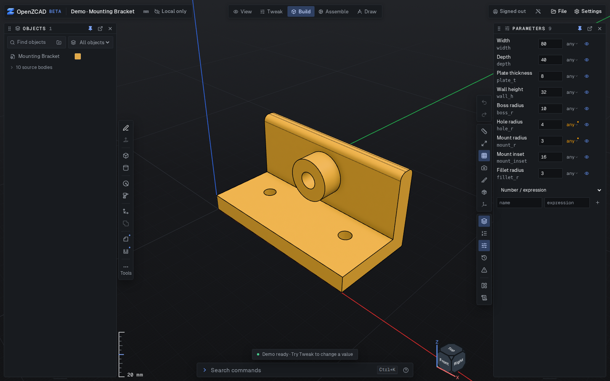
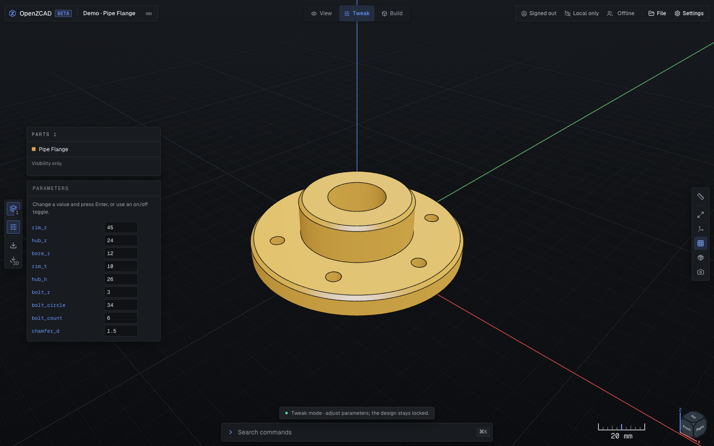
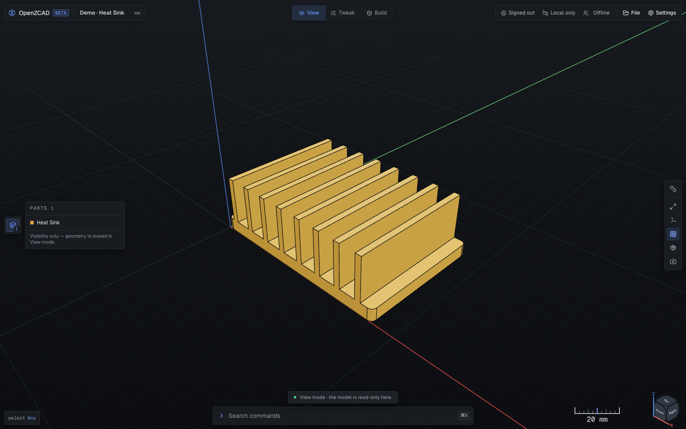
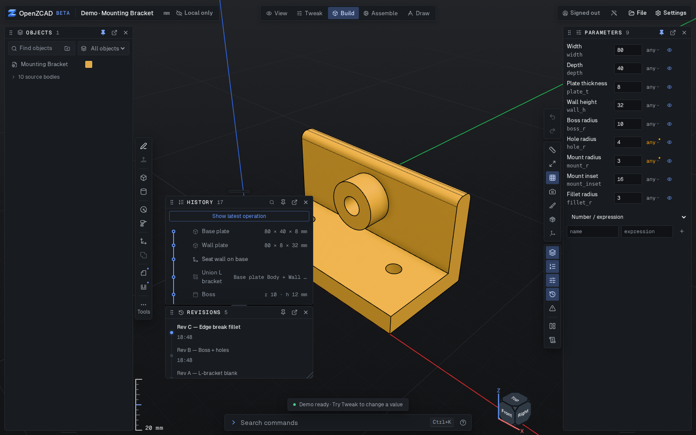
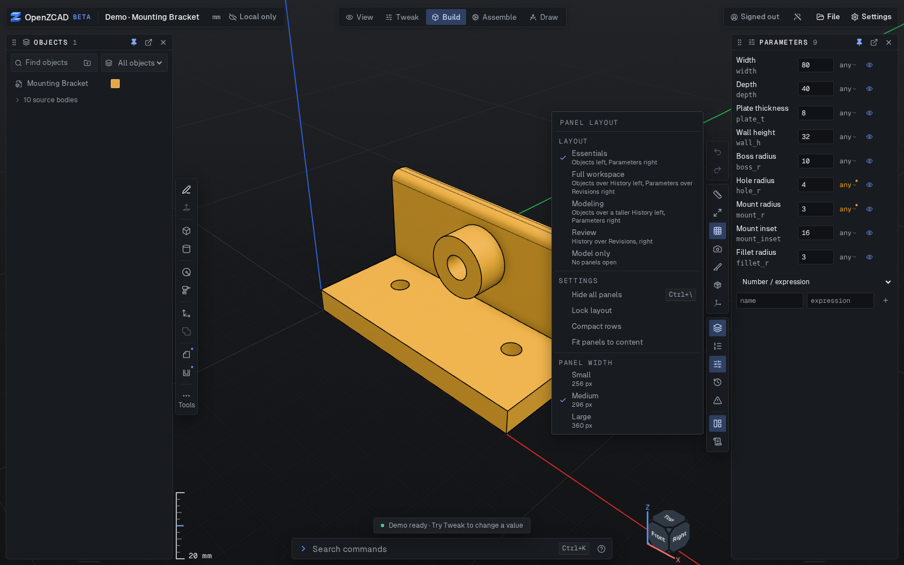

# OpenZCAD

OpenZCAD is a browser-first parametric CAD workspace: exact B-rep solid modeling, a replayable feature history, and direct on-model manipulation, with no install. The canonical project document stores named parameters, sketches, and an ordered command history, and a WebAssembly solid kernel rebuilds exact geometry in a background worker. Projects live on your device first; an optional account adds cloud projects, sharing, live collaboration, and end-to-end encryption.

Use it at [zcad.app](https://zcad.app/) (stable), or try the newest changes at [beta.zcad.app](https://beta.zcad.app/).

> [!WARNING]
> OpenZCAD is under active development and should be used at your own risk.
> Features and behavior may change without notice. Do not rely on a hosted
> channel as the only copy of important work: cloud projects and account data
> may be reset, migrated, or not carried forward to a future release. Keep
> independent local or exported backups of anything important.



_Build workspace in the default Essentials panel layout, captured 20 October 2026 from the built-in demos running locally._

## Highlights

**Exact parametric modeling.** Primitives, multi-profile sketch/extrude (including through-all cuts), revolve, loft, sweep and helical sweep, ribs, booleans, transforms, mirror, shell, solid offset, draft, thicken, fillet, chamfer, holes, linear/circular patterns, wrap/emboss onto cylinders and cones, and modeled screw threads, built on the [Remus](https://github.com/esaueng/remus) exact kernel. Standard parts generate parametric ISO and ANSI screws, nuts, washers, inserts, dowel pins and bearings. Datum planes, axes, points and coordinate systems support sketches, Split and Mirror. Sketches carry lines, arcs, circles, rectangles, polygons, and text, with a full constraint set, optional auto-constraining while drawing, driving and reference dimensions, and truthful degree-of-freedom status. Parametric expressions, configurations (a variant table over parameters, suppression and visibility), ordered history with editing, suppression and rollback, deterministic replay, and undo/redo.

**Direct manipulation.** Model on the geometry: drag a face to offset it, drag a sketch region into a solid, drag an edge to grow a fillet or chamfer, move/rotate bodies with a snapping gizmo — every drag pairs with exact numeric entry. Every Build tool runs as picks in the model with an exact preview. Box select, selection filters, a right-click menu, measurement, clearance and interference checks, and an Esc ladder round out the interaction model.

**A viewport-first workspace.** Five modes share one document: **View** to inspect, **Tweak** to adjust exposed parameters and export, **Build** for the full modeling tools, **Assemble** for components and joints, and **Draw** for drawing sheets. Floating controls keep the model at the centre. **Objects**, **History**, **Parameters**, **Revisions**, and **Diagnostics** are independent panels that dock in columns at either edge or float as windows, with layout presets remembered per device. `Ctrl/Cmd+K` opens command search; `Ctrl/Cmd+,` opens Settings over the workspace. Phones, iPad Safari (touch and Apple Pencil) and 3Dconnexion SpaceMouse navigation (Chrome and Edge) are supported in part.

**Assemblies and drawings.** Assemble grounds, joins and moves bodies with typed joints, animates them between limits, plays keyframed motion studies, and produces a deterministic bill of materials, exploded views, and pairwise interference. Draw places associative views, sections and details, dimensions, hole callouts, notes, title blocks, geometric tolerancing (ASME Y14.5 and ISO GPS symbols), and one-click auto-dimensioning, with PDF and DXF output.

**Import and export.** Editable STEP and IGES import is stored in replayable history and rebuilt exactly, honouring the file's declared units; STEP keeps names, colours and assembly structure. Imported faces support a validated direct-edit subset, and a bounded recognizer finds holes, counterbores, countersinks, bosses, pockets and tapers. STL, 3MF, OBJ, glTF binary and PLY import as mesh bodies. Export STEP, IGES, STL, 3MF, PLY, sketch DXF and SVG; send a print straight to a slicer, or lay parts flat for a CNC cut layout. **File › Units** converts a whole document's stored units. A migration path imports a [Shapr3D project paired with its STEP export](docs/shapr-import.md). All geometry and exports run in browser workers.

**Local-first, optionally cloud, optionally encrypted.** IndexedDB autosave works with no account, and **File → Export project** writes a complete `.openzcad` backup at any time (see [Project backups](#project-backups)). Optional passwordless accounts add cloud projects, named save states with previews, synced settings and project shelves, live collaboration with owner/editor/viewer roles and comments pinned to the model, and share links that let anyone view or tweak a model, or download its drawings, without an account. Projects can be [end-to-end encrypted](docs/adrs/ADR-024-end-to-end-encrypted-projects.md): the browser encrypts documents, revisions, sources, names, thumbnails and exports, unlocked by a passkey or recovery key, so the server stores only ciphertext and the metadata it needs to route it. When local and cloud copies diverge, OpenZCAD preserves both and asks which to keep.

**Automation.** The optional [AI assistant](docs/ai-assistant.md) turns plain-language requests into reviewable patches you preview before applying. The local [agent API](apps/agent-bridge/README.md) lets an agent of your choice edit a project file over the Model Context Protocol, and [history text and scripts](docs/scripting.md) print the feature history as editable text and run custom features. All three go through the same validation and exact preflight as a manual edit.

**One kernel, one topology language.** Remus builds every document, imported STEP included, and publishes exact topology witnesses and a safe subset of semantic lineage ([ADR-011](docs/adrs/ADR-011-unified-topology-identity.md), [ADR-013](docs/adrs/ADR-013-persistent-topology-lineage.md), [ADR-020](docs/adrs/ADR-020-remus-browser-kernel.md)). Verified lineage survives upstream edits within supported subsets; where it is not proved, references remain hash-only, and ambiguous or unsupported resolution fails closed.

<p align="center">
  
  
</p>

_Pipe Flange in Tweak mode (left) and Heat Sink in View mode (right)._

<p align="center">
  
  
</p>

_Model panels: History and Revisions stacked in a floating window (left), and the Panel layout menu (right)._

## Release channels

| Channel | Address                                 | Deploys from                       |
| ------- | --------------------------------------- | ---------------------------------- |
| Stable  | [zcad.app](https://zcad.app/)           | the `stable` branch, when promoted |
| Beta    | [beta.zcad.app](https://beta.zcad.app/) | `main`, on every merge             |

The channels share code but not accounts, projects, or sessions; the word beside the wordmark names the one you are on. See [Release channels](docs/release-channels.md). The app version (`YYYY.RELEASE.PATCH`) and the pinned kernel version are shown under **Settings → Advanced → About this build** ([App versioning](docs/versioning.md)).

## Quick start

Requires Node.js 20.19+ on the 20.x line, or Node.js 22.12+, and pnpm 10. The install needs network access: the lockfile pins a GitHub-hosted Remus kernel tarball.

```bash
pnpm install --frozen-lockfile
cp apps/web/.dev.vars.example apps/web/.dev.vars
pnpm dev:web
```

Open the URL Vite prints. The start screen offers three built-in demos: **Mounting Bracket**, **Pipe Flange**, and **Heat Sink**. Each includes revisions A → C so you can inspect how the model was built.

1. Open **Mounting Bracket**: on a new device the **Parameters** panel is docked on the right with its named dimensions, and **Objects** on the left to select and hide bodies or sketches.
2. Use the right-hand rail's **History** and **Revisions** buttons to inspect features and revisions, and **Pin** a panel to keep it docked.
3. Switch to **Tweak** to adjust exposed parameters, **View** to inspect the result, or **Draw** to make a drawing.
4. Use **File → Export project** for an editable backup, or export STEP/STL for downstream use.

Local development uses `AUTH_MODE=development` and an isolated development identity; the worker refuses to start if development authentication is combined with a guarded or non-development environment. See [Contributing](CONTRIBUTING.md) for development and pull request guidance, and [Security](SECURITY.md) for vulnerability reporting.

## Project backups

Use **File → Export project** to download an `.openzcad` backup of the entire
open project, independently of the selected body. The backup contains the
editable model, parameters, sketches, feature and command history, checkpoint
records, retained restorable save states, STEP source blobs, measurements, and
archived files. Display meshes rebuild from the model when it opens. An
encrypted project is decrypted in your browser for the export, so treat the
file as plaintext.

Use **Import project…** on the project screen or in the File menu to create a
separate local project. Its original remains unchanged. Sources, save states,
measurements, and archived files commit together; imported files remain
available under **Stored files** after an offline reload. The copy can later be
saved to your account using the existing project controls.

Backups use a versioned JSON container with SHA-256 checksums and a 256 MB
limit. Cloud-backed projects need access to their archived files and retained
save states; failed downloads stop export rather than create a partial backup.
Previously pruned save states retain their history records but cannot regain
snapshot contents that no longer exist. Account permissions, shelf placement,
viewport preferences, and the transient undo/redo stack are not transferred.

## Architecture

```text
React workspace (apps/web)
  ├─ canonical ProjectDocument + CommandManager   (source of truth)
  ├─ IndexedDB autosave
  ├─ end-to-end encryption (packages/crypto, packages/mls)
  ├─ Three.js viewport                            (disposable projection)
  └─ geometry Web Worker
       ├─ remus-wasm     — the exact B-rep kernel, for every document
       └─ remus-wasm-io  — its file-format translators, loaded only around import/export

Cloudflare Worker (orchestration only)
  ├─ D1 project metadata, documents, sessions, settings
  ├─ R2 artifact and project-object storage
  ├─ Email-code identity + owner authorization
  ├─ Durable Object live project rooms
  ├─ Encrypted-project key and ciphertext relay
  └─ AI assistant proposal stream (optional, experimental)
```

Boundaries that hold everywhere:

- The browser document/history model is the source of truth; meshes are disposable projections.
- Geometry and exports run in the browser worker, never in the Cloudflare Worker.
- Topology fingerprints are content-addressed and stable across rebuilds — checked in `test/kernel-seam.test.ts`, and against recorded baselines in bulk by the geometry corpus — and resolution is fail-closed at every call site.
- Documents carry a schema version (`PROJECT_DOCUMENT_SCHEMA_VERSION` in [`packages/shared/src/index.ts`](packages/shared/src/index.ts), which also records each version's change). Older documents migrate on load; a client refuses a document newer than it understands rather than guess, so update the app before opening one.

See [architecture.md](architecture.md) and the decision records in [docs/adrs](docs/adrs).

### Repository layout

A pnpm workspace:

| Path                                                    | Contents                                                                                |
| ------------------------------------------------------- | --------------------------------------------------------------------------------------- |
| `apps/web`                                              | The React workspace, its Cloudflare Worker, and the geometry worker                     |
| `apps/desktop`                                          | Tauri 2 shell for Apple Silicon macOS ([docs/macos](docs/macos/README.md))              |
| `apps/ipad`                                             | Offline native iPad prototype around the same workspace ([README](apps/ipad/README.md)) |
| `apps/agent-bridge`                                     | `openzcad-mcp`, the local agent API server ([README](apps/agent-bridge/README.md))      |
| `packages/document-core`                                | Canonical project model and expressions                                                 |
| `packages/command-system`                               | Commands, transactions, undo/redo                                                       |
| `packages/geometry`                                     | Sketch regions and plane math                                                           |
| `packages/kernel-adapter`                               | The Remus exact adapter and its pinned kernel packages                                  |
| `packages/viewport`                                     | React-free three.js scene framework                                                     |
| `packages/io-step`, `io-stl`, `io-dxf`, `io-shapr`      | File-format readers and writers                                                         |
| `packages/crypto`, `packages/mls`                       | End-to-end encryption formats and the MLS group-key layer                               |
| `packages/ai-contracts`, `agent-api`, `scripting`       | Patch schemas, the agent API, history text and scripts                                  |
| `packages/persistence`, `cloudflare-adapters`, `shared` | Storage, Worker adapters, shared types                                                  |

## Development

```bash
pnpm dev:web             # Vite + local Cloudflare Worker
pnpm typecheck           # TypeScript
pnpm lint                # ESLint
pnpm test                # root and web Vitest projects
pnpm test:parity-corpus  # serial Remus corpus against recorded baselines
pnpm test:e2e            # Playwright end-to-end suite (builds and serves the app)
pnpm build               # production web/worker bundle + bundle-size check
```

These are the gates pull requests must pass. `pnpm test:full` forces the complete Vitest suites even where CI selects affected tests; see [Unit test suites](docs/unit-test-suites.md) and [Browser test suites](docs/browser-test-suites.md).

Never deploy `apps/web/wrangler.jsonc`: it is a development-only config that binds a placeholder database ID so it cannot write to hosted data. When R2 or Durable Object bindings are absent, the affected routes return a clean `FEATURE_DISABLED` 501.

### macOS desktop (Tauri)

`apps/desktop` bundles the same web workspace for Apple Silicon; geometry still runs in the browser workers, and the Rust host stays narrow — native menus, user-picked CAD files, exports, and window-state restoration. The app signs in through the browser, so no password or session cookie passes through the native shell. It needs macOS 14+, Xcode Command Line Tools, and current stable Rust with the `aarch64-apple-darwin` target (the locked dependencies require Rust 1.88 or newer):

```bash
pnpm dev:desktop      # tauri dev against the local workspace
pnpm build:desktop    # .app and DMG for aarch64-apple-darwin (ad-hoc signed)
```

See [docs/macos/README.md](docs/macos/README.md) for setup, the WKWebView smoke test, and the manual desktop CI workflow. The iPad prototype builds with `pnpm dev:ipad` on macOS with Xcode ([apps/ipad](apps/ipad/README.md)).

### Performance

Interaction and startup performance are measured, not guessed — see [docs/performance-baseline.md](docs/performance-baseline.md) for the committed baselines and history. Rendering is on demand, and the exact adapter and Remus WASM load lazily inside the geometry worker on the first non-empty rebuild or export. Canonical rebuild results use a bounded worker-local LRU ([ADR-015](docs/adrs/ADR-015-bounded-exact-rebuild-cache.md)). Reproduce the interaction numbers with:

```bash
OZ_PERF=1 pnpm exec playwright test interaction-probe
```

## Deploying and self-hosting

OpenZCAD runs on Cloudflare Workers, D1, R2 and Durable Objects. The browser application still works offline without them.

- [Self-hosting OpenZCAD](docs/SELF_HOSTING.md) — deploy an independent instance in your own Cloudflare account with `pnpm deploy:selfhost`, including the end-to-end encryption requirements.
- [Operating OpenZCAD](docs/operations.md) — the official deployment, sign-in security, health and liveness checks, and the API surface.
- [Release channels](docs/release-channels.md) and the [cloud-sync release runbook](docs/runbooks/project-cloud-sync-release.md).

`pnpm deploy:beta`, `pnpm deploy:stable` and `pnpm deploy:selfhost` apply remote D1 migrations before deploying, so they need credentials and explicit authorization; they are not validation commands.

## Known limitations

- Editable STEP sources are stored content-addressed: the document carries a SHA-256 reference and the bytes live in the browser's IndexedDB blob store (imports up to 128 MB), with the archived upload artifact as the cross-device fallback. Cloud saves keep project payloads in checksum-verified R2 objects and only metadata and pointers in D1.
- Imported meshes — STL, 3MF, OBJ, glTF binary and PLY — stay mesh bodies: no parametric reconstruction is attempted, and a boolean against an exact body is refused by name rather than approximated. One import is one body, and for every format but STL a file whose triangles the rebuild cannot take is refused by name at import, checked at the open document's units, because the sew tolerance follows the document's stored numbers. STL keeps readable meshes within the 200,000-triangle browser limit, including open and non-manifold ones; one that cannot be sewn stays a displayable mesh reference with no solid volume or STEP export, but keeps STL export, Move, scale, save and reopen.
- Native CAD formats (Parasolid, ACIS, Rhino, SolidWorks and others) are not yet supported.
- Remus's difficult boolean cases can fall back to mesh-derived topology, and closed-B-spline/NURBS-blend faces are not fingerprint-stable — they fail closed rather than mis-resolve. Unsupported kernel combinations refuse with a typed reason rather than produce a questionable solid.
- Coordinated editing of imported features covers hole bindings and diameter changes; hole depths, countersink angles, bosses, pockets and tapers remain read-only.
- Assemblies do not yet solve closed loops or couple joints; drawings and assemblies live within a single document.
- Collaboration rooms reject documents over about 1.5 MB of JSON.

## Roadmap

The [master roadmap](ROADMAP.md) is the single ledger of delivered capabilities, the ordered work queue, completion criteria and links to detailed specifications. Current priorities are kernel correctness and edit latency, then encryption, sketch and part-modeling depth, assembly couplings, and native-CAD exchange.

## License

Apache License 2.0 — see [LICENSE](LICENSE). Copyright 2026 Esau Engineering LLC. See [THIRD-PARTY-NOTICES.md](THIRD-PARTY-NOTICES.md) for bundled dependency and font notices.
