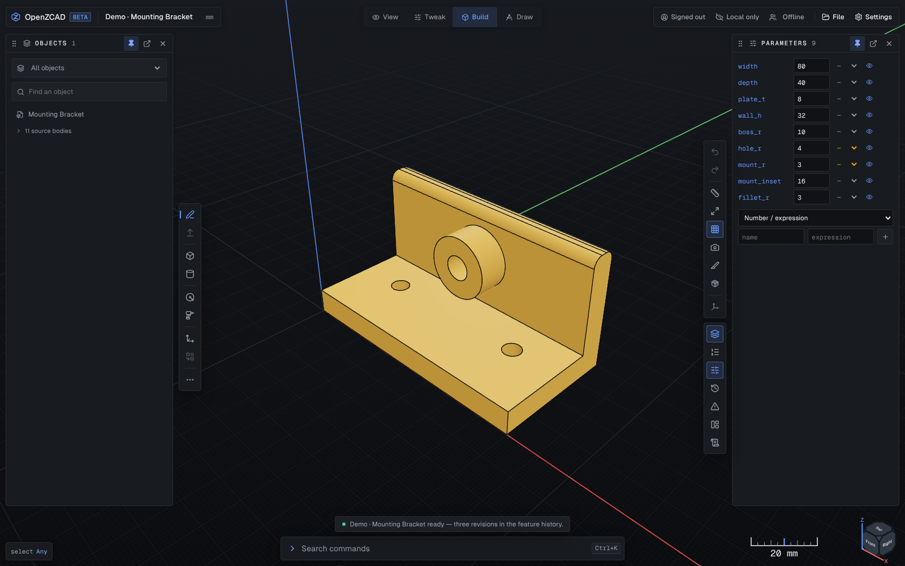
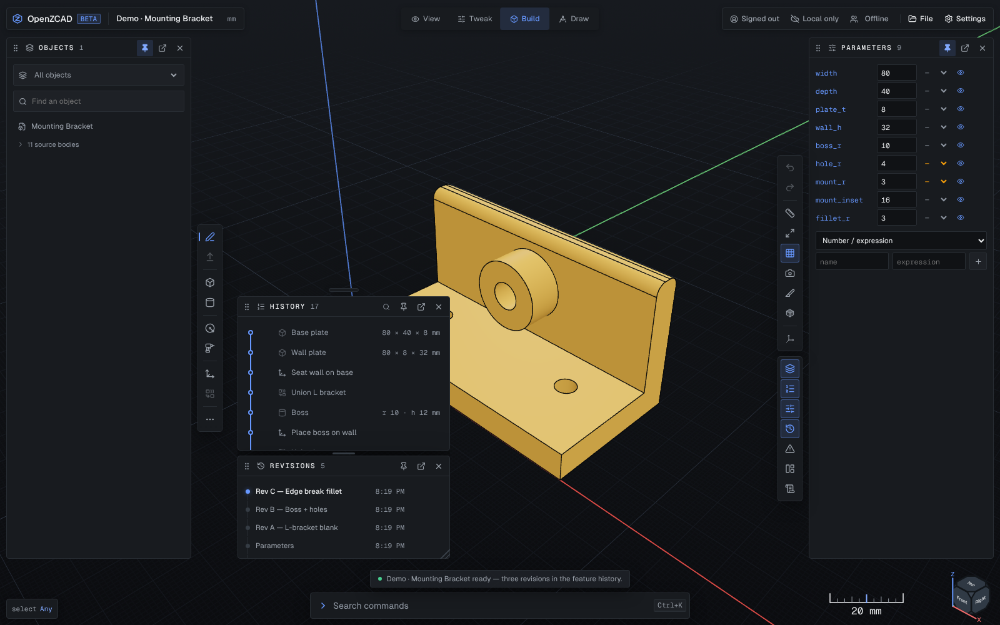
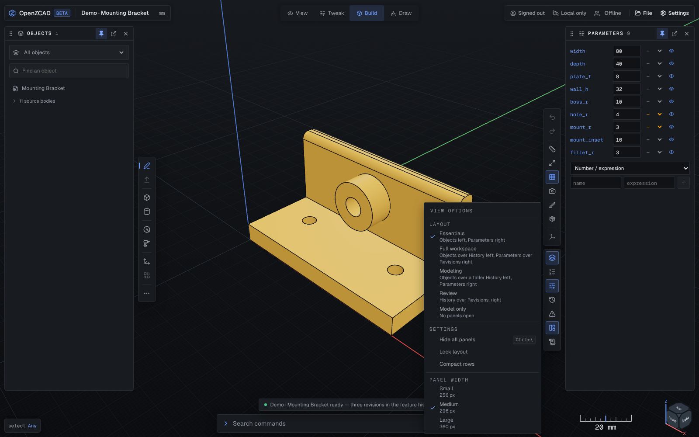

# OpenZCAD Workspace Design Specification

The accepted workspace concept is [`openzcad-workspace-concept.png`](./openzcad-workspace-concept.png). The concept was generated with OpenAI's image tooling and intentionally retains its C2PA Content Credentials; it is a design reference, not an application asset.

## Product hierarchy

1. The exact B-rep viewport is the primary surface.
2. The model tree and contextual inspector are compact rails, not dashboards.
3. AI work is always presented as a reviewable patch with Preview, Apply patch, and Reject controls.
4. Applying a patch is explicit and atomic. A proposal never appears already applied.

## Layout

- Compact top application bar.
- Narrow model rail on wide screens.
- Flexible viewport with a contextual inspector.
- Bottom AI rail with proposal summary and approval controls.
- Compact status bar.
- Small-laptop layouts may collapse either side rail into a drawer, but the viewport and AI approval boundary remain visible. As built, the model browsers are dockable panels (see [Model panels](#model-panels)), and a stage 720 px wide or less shows one panel at a time instead of docking.

## Visual system

- Near-black engineering canvas and graphite rails.
- Cool neutral text with deliberate high contrast.
- Electric blue for selection, focus, and primary actions.
- Warm amber-gold body color for the active solid.
- One-pixel borders, minimal shadows, and 4-8px radii.
- Modern sans-serif UI typography; monospace is limited to values and status.

## Allowed primary-screen copy

- OpenZCAD
- Mounting Bracket
- Saved
- Undo
- Redo
- Import
- STEP
- STL
- MODEL
- Parameters
- Feature history
- Hole
- Measurements
- Apply
- Cancel
- AI command
- Proposed patch
- Preview
- Apply patch
- Reject
- Exact B-rep
- 0 warnings
- Synced

## Component families

- Application bar actions and icon buttons.
- Model-tree section, parameter row, and feature row.
- Viewport overlays: view cube, axis triad, Fit, and Grid.
- Contextual inspector fields, toggles, actions, and measurements.
- AI command editor, ordered patch operations, assumption line, and approval actions.
- Status items for kernel, units, diagnostics, and synchronization.

All visible controls and text are code-native. The concept image is a visual specification, not an application asset.

## Fidelity ledger

- Preserved: graphite shell, blue selection/actions, warm gold active bodies, top project/actions bar, model tree, grid viewport, inspector, AI proposal rail, and exact/sync status.
- Density adaptation: the implemented rails use 46px/252px/330px/28px dimensions so more viewport remains available on common laptop displays.
- Functional adaptation: the live viewport displays the user's actual model rather than a hard-coded mounting bracket.
- Functional adaptation: the compact rail shows the proposal summary; Preview makes the proposed geometry inspectable before Apply. Without an AI API key, the rail reports the configuration state.
- Functional adaptation: authenticated identity and live-room presence sit in the top bar without displacing the core modeling actions.
- Functional adaptation: finishing and pattern tools extend the contextual inspector while preserving the concept's compact tool density; exact face/edge IDs appear only when selected.
- Direct modeling adaptation: literal box dimensions can be changed by dragging an exact selected face, with a live numeric HUD and a single document-history command on release. Expression-driven dimensions are deliberately preserved for inspector editing.
- Selection-order adaptation: fillet and chamfer accept either edge-first or tool-first workflows while still storing stable exact edge hashes in the canonical feature.
- QA result: the implemented layout, rail hierarchy, control density, typography, graphite/blue visual system, and core viewport-first workflow remain faithful to the concept. The live QA capture uses actual exact fillet and pattern geometry rather than concept-only sample content.
- Compact breakpoints preserve the model and viewport first; the inspector hides only below 820 px, where full CAD editing is not the primary target.
- Layout adaptation (U08): the model tree and its sibling browsers are five independent model panels rather than one rail or drawer, so Parameters and Objects can be open side by side and the model keeps at least 40% of the stage width for the docked layout.

## Model panels

Parameters, Objects, History, Revisions and Diagnostics are independent panels (U08). The contract is the [dockable model panels plan](../plans/dockable-panels-plan-2026-10-20.md); the [roadmap row](../../ROADMAP.md#u08) records what shipped.

- **Header.** Drag grip (also the keyboard **Move** menu), icon, title and count, **Pin**, **Pop out** and **Close**. Panels never fold; room comes from resizing, closing or moving them.
- **Unpinned.** A rail press opens a panel beside the rail's inner edge. One panel is unpinned at a time, the next one replaces it, and clicking the model leaves it open; its footer offers Pin.
- **Docked.** Pin docks a panel. The right dock holds up to three columns and the left up to two, each dock's rail on its inner edge. Columns stack panels, and the gap between two resizes them (90 px minimum) or, on a double-click, splits them evenly. Close remembers where a panel was, and its rail button reopens it there.
- **Floating.** Pop out, or a drop on the model, floats a panel as a window that moves by its header and resizes from its corner (260–600 px wide, at least 160 px tall). Dropping a panel on a window stacks the two; a press, focus, rail press or ⌘K brings a window to the front.
- **Dragging.** A header or a rail icon dragged 4 px or more lifts the panel to a title chip, and a slot preview shows where it will land: a column, a new column past either rail, a window, or a new window. The Move menu (Dock left/right, New column left/right, Float, Move to, Move up/down, Close) and `Alt+↑`/`Alt+↓` reach every slot from the keyboard.
- **View options.** The rail's View options menu picks a preset — **Essentials** (Objects left, Parameters right, a new device's layout), Full workspace, Modeling, Review or Model only — and holds Hide all panels (`Ctrl+\`, `⌘\` on macOS), Lock layout, Compact rows and Panel width S/M/L (256/296/360 px).
- **Narrow stages.** The docks take at most 60% of the stage width; columns that do not fit are parked (left before right, outermost first) and open from their rail buttons. At 720 px and below nothing docks or floats: one panel shows at a time in the phone lane.
- **Persistence.** The layout is per device, in `openzcad-panel-layout:v1`, beside the older `openzcad-panel-state:v1`, which it migrated from.

The captures are 1600 × 1000 and come from `test/e2e/docs-captures.spec.ts`, which seeds each layout and runs only with `OZ_CAPTURE=1` (`OZ_CAPTURE=1 pnpm exec playwright test test/e2e/docs-captures.spec.ts`); the committed PNGs were then re-saved with lossless optimisation.

## Viewport chrome studies

- [`viewer-rail-options.html`](./viewer-rail-options.html) — five redesigns of the right-hand viewer rail (`ViewerToolbar`), each rendered live at 1:1 against a mock viewport, with measured footprints and the trade-offs behind each. Open it in a browser; no build step or network access is required. Option C shipped; the page records the alternatives and the reasoning.
