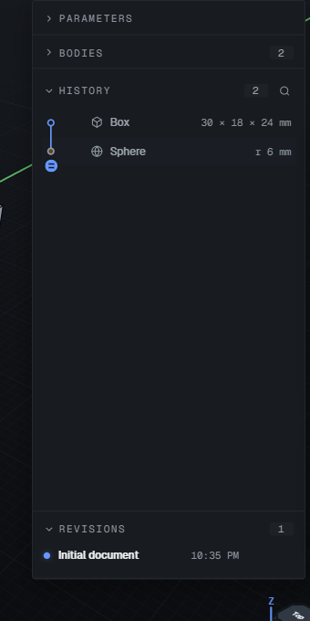
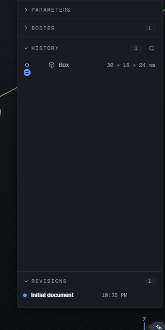
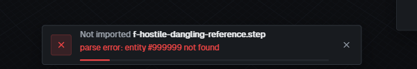
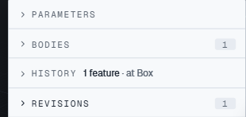

# Production QA in Microsoft Edge — 11 October 2026

## Environment and scope

Site: <https://zcad.app>. This is a production browser assessment, with no
application changes. ROADMAP [L01](../../../ROADMAP.md#l01) owns the EDGE-03
persistence finding; [U03](../../../ROADMAP.md#u03) owns the UX assessment
context. This report does not certify the full feature catalogue.

| Item                   | Recorded value                                                                                                                    |
| ---------------------- | --------------------------------------------------------------------------------------------------------------------------------- |
| Build at start and end | `635e605681deabcc5ac2d7b2c79b9acf53b2adf2`                                                                                        |
| Remus at start and end | `2026.1.52`, commit `4a262a1c50a2247dd7714c566a70b1b795136bdb`                                                                    |
| Repository comparison  | Matched fetched `origin/main`, integration PR #644                                                                                |
| Edge                   | Microsoft Edge **155.0.4283.45**; Chromium 155.0.8059.40; brand and `Edg/` verified in both drivers                               |
| Operating system       | Windows; UA Windows NT 10.0, platform version 19.0.0. macOS was unavailable                                                       |
| Driver B GPU           | Intel UHD Graphics (0x00009BC4), ANGLE / Direct3D11, shader model 5.0                                                             |
| Primary rendering      | Headed Edge, 1280 × 800 CSS px, nominal DPR 2                                                                                     |
| Driver A rendering     | User Edge extension, own tab; 1991 × 1068 viewport, 2048 × 1152 screen, DPR 1.25                                                  |
| Authentication         | Driver A was already signed in and remained read-only on the start screen. Driver B stayed signed out                             |
| Edge preferences       | Enhanced security, tracking prevention, efficiency mode and native page zoom were not inspected or changed                        |
| App preferences        | Dark, Light and System exercised; Compact primary, Comfortable persistence spot check                                             |
| Timing                 | Driver B session through background check: 21:51:26–22:47:46 EDT on 11 October 2026 (56 min 20 s); includes harness and idle time |

Driver A used the available Edge browser-control extension rather than the
brief's named extension. Driver B used headed Playwright with `channel:
'msedge'`, real production requests and a disposable local profile. No app API
stubs, document injection or `openzcad:e2e-*` hooks were used. Scripts, raw logs,
exports and the disposable profile stay outside the repository. Downloads were
explicitly approved once. No user project was opened or edited; **zero QA
projects remain in the user's Edge profile**, and the agent-created tab was
closed. Cloud, sharing and assistant workflows were not authorized or exercised.

## Summary

Three confirmed findings: **P0: 1; P1: 0; P2: 0; P3: 2**. Tags:
`functional` 1, `copy` 1, `a11y` 1, `visual` 1, `perf` 0, `edge-only` 0.

| Priority | Finding                                                                                    | Classification                                                                   |
| -------- | ------------------------------------------------------------------------------------------ | -------------------------------------------------------------------------------- |
| P0       | **EDGE-03:** reloading while a new local feature is saving loses that feature              | New                                                                              |
| P3       | **EDGE-01:** malformed STEP import exposes a parser message without a recovery instruction | New copy finding; preservation of the technical message is intentional in source |
| P3       | **EDGE-02:** drawer disclosure buttons retain a 14.4 px pointer hitbox                     | Known-open, G14 / F23                                                            |

The plate and parameter-driven bracket journeys now feel substantially more
coherent: primitive previews, inline parameter definition, plain command search,
dependent-suppression dialogs and neutral committed solids worked in the tested
paths. STEP round trips and FCStd volumes supplied useful numeric evidence.
However, a local CAD application's trust depends on preserving accepted edits.
EDGE-03 prevents a clean verdict against the product goal until the pending-save
departure window is addressed. The broad advanced-tool, constraint and Edge
preference gaps below also prevent treating this as an exhaustive release gate.

## Coverage matrix

“Passed” applies to the stated case, not to every variant of the feature.

| Plan item                     | Status  | Evidence and limit                                                                                                                                                                                                             |
| ----------------------------- | ------- | ------------------------------------------------------------------------------------------------------------------------------------------------------------------------------------------------------------------------------ |
| A1 Cold Driver B load         | Passed  | Empty library, worker-backed modeling, console/network capture; 1,348 ms start-screen proxy                                                                                                                                    |
| A2 Driver A load              | Partial | Own-tab navigation and environment inspection; 825 ms load event. Hard-reload instrumentation parity was not completed                                                                                                         |
| A3 First paint                | Partial | Loaded Geist faces, title, visual review and CLS below 0.05; no filmstrip or independent favicon inspection                                                                                                                    |
| A4 Start screen               | Partial | Empty and populated libraries and creation exercised. Three production demos exist; long-name boundary cases not run                                                                                                           |
| A5 Tour                       | Passed  | Four steps inspected and finished; did not recur on later project creation                                                                                                                                                     |
| A6 Reload mid-tool/sketch     | Partial | Pending feature departure tested in EDGE-03; reopening an active sketch draft not covered                                                                                                                                      |
| B1 Plate                      | Passed  | 100 × 60 × 6 box, two Ø6 through holes at V ±40, front top edge fillet; radius 7 refused with 5.5 hint, radius 3 accepted; undo/redo                                                                                           |
| B2 Parametric bracket         | Passed  | Inline `width=80`; two boxes, union, inside fillet 3, holes at ±(width/2−15); width 120 then Tweak width 60; six features survived reload                                                                                      |
| B3 Sketching                  | Partial | XY entry upright; line chain, arc, circle, rectangle and QA text drawn. Other planes, face attachment and all twelve constraints not validated                                                                                 |
| B4 From sketch                | Partial | Rectangle selected by real click, zero-distance explanation and disabled Create; −8 mm preview and committed extrusion. Other operations not completed                                                                         |
| B5 Every tool valid/invalid   | Partial | Per-tool table below; card inspection is not a successful geometry test                                                                                                                                                        |
| B6 Direct manipulation        | Partial | Move gizmo and extrusion handles visually inspected; complete stepped handle, fine movement and Escape rollback contract not tested                                                                                            |
| B7 History / expressions      | Partial | Early Box edit, dependent suppression, dependent-delete dialog and Undo; units, unknown identifiers and invalid expressions. Full rollback/reorder and extreme-scale commits not run                                           |
| B8 Selection                  | Partial | Q cycle, real top-face and concave-edge picks, body rows and boolean multiple selection. Window/crossing, stacked cycling, smooth runs and pick-list shortcuts not validated                                                   |
| B9 Viewport                   | Partial | 1–4, F, W and P; stepped orbit on all demos; screenshots after views. Full pan, pointer zoom, section, clipping and normal-to-face checks not completed                                                                        |
| B10 Modes                     | Partial | Ctrl+Shift+M entered View; M opened Measure and Escape exited; Tweak parameter edit passed. Measurement creation/deletion not tested                                                                                           |
| B11 Demos                     | Partial | All three shipped demos rendered; histories showed 17 / 10 / 7 features. No demo parameter edits or suppression were performed                                                                                                 |
| B12 Imports                   | Partial | Listed valid fixtures rendered; FCStd, cavity and NURBS numeric checks below; hostile refusals. Imported-face editing and numeric checks on every fixture not completed                                                        |
| B13 Exports                   | Partial | Twelve requested solid/mesh exports nonempty; bracket STEP bounds/volume matched; plate STEP-backed backup restored. Original plate feature-history backup and sketch DXF not completed                                        |
| B14 Persistence               | Failed  | Ordinary bracket reload passed. EDGE-03 lost a pending feature online and offline. Offline modeling accepted a Sphere; immediate reload lost it. Two-tab lock and actual tab-close recovery not tested                         |
| B15 Settings                  | Partial | Every section visually inspected in both themes at primary viewport; theme, density, motion and enabled viewport/sketch checkbox persistence sampled. Numeric options, all select choices and Files/autosave toggles not swept |
| B16 Command bar               | Partial | Plain `fil` found Fillet without an assistant, tool commands and Go-to-feature rows appeared, Enter ran tools and Escape closed. Full file/view search and Tab completion not tested                                           |
| B17 Shortcuts                 | Partial | Individual status table below                                                                                                                                                                                                  |
| B18 Keyboard only             | Partial | Controls dialog trapped six consecutive Tabs, alternating Close and scroll region, with visible focus; all other dialogs and full focus-return paths not swept                                                                 |
| B19 Races                     | Partial | 50-copy cancellation preserved source and undo history; immediate reload race reproduced. Double-submit, project-switch, resize-during-drag and Escape-during-import variants not completed                                    |
| B20 Performance               | Partial | Single-run load proxies, Box edit UI proxy, demo FPS, long tasks and heap; no isolated kernel-ready or GPU completion timestamp                                                                                                |
| B21 Cloud                     | Skipped | No opt-in; user profile read-only, disposable profile signed out                                                                                                                                                               |
| B22 Assistant                 | Skipped | No opt-in or provider use                                                                                                                                                                                                      |
| C1 Enhanced security          | Skipped | Browser preferences left untouched; setting not inspected                                                                                                                                                                      |
| C2 Strict tracking prevention | Skipped | No browser setting changes or authenticated challenge exercise                                                                                                                                                                 |
| C3 InPrivate                  | Skipped | Disposable regular profile is not an InPrivate test                                                                                                                                                                            |
| C4 Native page zoom           | Partial | Responsive viewport matrix below; not equivalent to the six requested native zoom percentages                                                                                                                                  |
| C5 Edge chrome interference   | Skipped | Sidebar, autofill, translate, native context-menu and mini-menu cases not tested                                                                                                                                               |
| C6 Forced colors / motion     | Partial | Box card readable under active forced colors + more contrast; reduced-motion app preference persisted. Selection and animation conformance not exhaustively checked                                                            |
| C7 Background recovery        | Partial | Returned after 11 min 48 s in a normal background tab: same stored Box/history, live WebGL context, responsive workspace. This does not prove Edge actually slept or discarded the tab                                         |
| C8 Physical trackpad          | Skipped | Hardware gestures not available to the automation                                                                                                                                                                              |

### Tool coverage

| Tool             | Valid geometry                                           | Invalid/refusal / other coverage                                                                   |
| ---------------- | -------------------------------------------------------- | -------------------------------------------------------------------------------------------------- |
| Sketch           | XY entities drawn                                        | Full invalid/constraint case not run                                                               |
| Box              | Created and early feature edited                         | Zero, negative, empty, unknown and malformed expressions refused                                   |
| Cylinder         | Created at an offset                                     | Negative radius disabled Create                                                                    |
| Sphere           | Created at an offset and offline                         | Negative radius disabled Create                                                                    |
| Cone             | Created at an offset                                     | Negative bottom radius disabled Create                                                             |
| Torus            | Created at an offset                                     | Negative ring radius disabled Create                                                               |
| Extrude          | −8 mm rectangle extrusion                                | Zero distance disabled Create with explanation                                                     |
| Revolve          | Not completed                                            | Unavailable without a sketch; enabled entry inspected                                              |
| Loft             | Not completed                                            | Entry inspected; no two-profile commit                                                             |
| Sweep            | Not completed                                            | Entry inspected; no path/profile commit                                                            |
| Helical sweep    | Not completed                                            | Entry inspected; no commit                                                                         |
| Fillet           | Plate and bracket, radius 3                              | Radius 7 plate refusal actionable                                                                  |
| Chamfer          | Not completed                                            | Card opened/canceled; no edge commit                                                               |
| Hole             | Plate and bracket through holes                          | Card and preview inspected; separate invalid geometry case not completed                           |
| Shell            | Not completed                                            | Card opened/canceled; commit harness used wrong action name                                        |
| Draft            | Not completed                                            | Card opened/canceled                                                                               |
| Thicken          | Not completed                                            | Card opened/canceled                                                                               |
| Solid offset     | Not completed                                            | Card opened/canceled; commit harness used wrong action name                                        |
| Move             | Not completed                                            | Real gizmo opened; it is a direct-edit surface, not the generic tool-card region                   |
| Scale            | Not completed                                            | Card opened/canceled                                                                               |
| Mirror           | Not completed                                            | Card opened/canceled; commit harness used wrong action name                                        |
| Split            | Not completed                                            | Card opened/canceled; commit harness used wrong action name                                        |
| Union            | Bracket committed with Enter                             | Empty/incomplete body selection disabled submission                                                |
| Subtract         | Box/Cylinder committed with Enter; Undo restored sources | Incomplete body selection disabled submission                                                      |
| Intersect        | Box/Cylinder committed with Enter; Undo restored sources | Incomplete body selection disabled submission                                                      |
| Linear pattern   | Default three-copy result committed; undo/redo exercised | Count 0 disabled Create                                                                            |
| Circular pattern | Successful result not established                        | Count 0 disabled; default overlap refused without approximate geometry; 50-copy operation canceled |
| Grid pattern     | Default 3 × 3 result committed; undo/redo exercised      | Count 0 disabled Create                                                                            |

Interaction counts were not instrumented consistently. The completed plate had
four features and the bracket six; the plate involved one intentional fillet
refusal and a corrected radius. Exact click/keypress comparisons with the prior
review are unavailable. Selector retries are harness work, not product failures.

### Import and export observations

| Import                          | Observed result                                                                                        |
| ------------------------------- | ------------------------------------------------------------------------------------------------------ |
| `two-solids.FCStd`              | Two live bodies: **6,000 mm³**, 10 × 20 × 30 mm; **480 mm³**, 5 × 8 × 12 mm; no observed CSP violation |
| `b-unit-inch-cube.step`         | Solid rendered; numeric inch-scale readout was not captured, so unit correctness is not certified      |
| `c-void-two-cavities.step`      | One live solid, **11,272 mm³**, 30 × 20 × 20 mm, 18 faces                                              |
| `d-multi-solid-and-void.step`   | Two bodies rendered; individual volumes not captured                                                   |
| `parametric-bracket.step`       | Solid rendered; inspector was still preparing during capture                                           |
| `lemon-torus-band.step`         | Curved solid rendered without an obvious missing patch at inspected zoom                               |
| `nurbs-trimmed-cylinder.step`   | Live solid, **240.64 mm³**, 4 × 8 × 10 mm, five faces                                                  |
| `synthetic-holder.step`         | Solid rendered with its curved cutouts; progress and workspace remained responsive                     |
| `box.obj`, `box.ply`            | Each imported as twelve triangles                                                                      |
| Hostile open shell              | Refused: five faces, four singly used edges, no enclosed volume; app remained usable                   |
| Hostile dangling reference      | Refused twice; EDGE-01                                                                                 |
| Hostile no shape representation | Refused: “STEP file contains no solids.” App remained usable                                           |

The first FCStd attempt was interrupted by the harness switching projects too
early; the app refused the late result because the project had changed while
the import finished. A properly awaited repeat succeeded. This is not an
import defect. `samples/simple-assembly.step` is a metadata-only sample and
`samples/simple-block.stl` contains two triangles; neither was treated as a
closed-solid reference or used for a geometry correctness claim.

| Format     | Plate bytes | Bracket bytes |
| ---------- | ----------: | ------------: |
| STEP       |      15,212 |        20,346 |
| 3MF        |       2,894 |         3,032 |
| Binary STL |      10,184 |        10,984 |
| ASCII STL  |      43,094 |        45,271 |
| OBJ        |      16,672 |        18,379 |
| GLB        |       7,644 |         8,316 |

Extensions matched the requested formats; no independent format parser was run.
The bracket's re-imported STEP read **60 × 40 × 40 mm, 22,333.14 mm³, 11 faces**,
matching the original bracket inspector. The plate STEP read **100 × 60 × 6 mm,
35,467.57 mm³, nine faces**. A **29,388-byte `.openzcad` backup** of that imported
plate restored one import feature and one body. This did not validate recovery
of the original four-feature plate history or remeasure the restored volume.
The original nonpersistent harness context ended before its backup was made.

## Visual matrix

Cells are **Dark / Light**. P = visually passed the stated state, O = opened or
sampled with incomplete variants, N = not run. All dimensions are CSS pixels;
the main matrix used DPR 2 and Compact density. Box P includes System with both
OS color-scheme emulations. Comfortable was checked for preference persistence,
not a repeat of the complete matrix. A DPR 1 emulation attempt still reported
DPR 2 and is excluded.

| State                                            | 1920×1080 | 1440×900 | 1280×800          | 1024×768 | 768×1024 | 390×844 |
| ------------------------------------------------ | --------- | -------- | ----------------- | -------- | -------- | ------- |
| Empty start                                      | N/N       | N/N      | P/N               | N/N      | N/N      | N/N     |
| Populated start                                  | N/N       | N/N      | P/N               | N/N      | N/N      | N/N     |
| Empty workspace                                  | N/N       | N/N      | P/N               | N/N      | N/N      | N/N     |
| All ten Settings sections                        | N/N       | N/N      | P/P               | N/N      | N/N      | N/N     |
| Box card, valid                                  | P/P       | P/P      | P/P               | P/P      | P/P      | P/P     |
| Other tool cards                                 | N/N       | N/N      | O/N               | N/N      | N/N      | N/N     |
| Invalid/refusal cards                            | N/N       | N/N      | O/N               | N/N      | N/N      | N/N     |
| Tour steps                                       | N/N       | N/N      | P/N               | N/N      | N/N      | N/N     |
| Sketch entities / text card                      | N/N       | N/N      | P/N               | N/N      | N/N      | N/N     |
| Constraint glyphs / dimensions                   | N/N       | N/N      | N/N               | N/N      | N/N      | N/N     |
| Extrude preview and handles                      | N/N       | N/N      | P/N               | N/N      | N/N      | N/N     |
| Move gizmo                                       | N/N       | N/N      | P/N               | N/N      | N/N      | N/N     |
| Selection callouts                               | N/N       | N/N      | O/N               | N/N      | N/N      | N/N     |
| Stacked-target pick lists                        | N/N       | N/N      | N/N               | N/N      | N/N      | N/N     |
| History ≥20 / parameters ≥10                     | N/N       | N/N      | N/N               | N/N      | N/N      | N/N     |
| Import progress / notices                        | N/N       | N/N      | O/N               | N/N      | N/N      | N/N     |
| Export dialogs                                   | N/N       | N/N      | P/N               | N/N      | N/N      | N/N     |
| Delete / suppress dialogs                        | N/N       | N/N      | P/N               | N/N      | N/N      | N/N     |
| Properties / unapplied-card / conflict / sharing | N/N       | N/N      | N/N               | N/N      | N/N      | N/N     |
| Controls reference                               | N/N       | N/N      | P/N               | N/N      | N/N      | N/N     |
| Command results                                  | N/N       | N/N      | P/N               | N/N      | N/N      | N/N     |
| Drawer header hitboxes                           | N/N       | N/N      | EDGE-02 / EDGE-02 | N/N      | N/N      | N/N     |

The Box matrix showed no horizontal page overflow, and dimensions plus Create
and Cancel remained reachable at 390 px. This certifies that card's reachability,
not a usable full CAD journey on a phone. The visual lint was a screening aid:
it counted controls inside closed File details and underlying modal content as
occluded, and miscomputed light-theme cube contrast against a non-canvas
ancestor. Those were not filed. Screenshots/contact sheets were inspected to
separate these artifacts from visible defects.

## Findings

### EDGE-03 — Reload during local save loses the latest accepted feature

**P0 · functional · New · hands-on.** Environment: Driver B, signed out,
1280 × 800, DPR 2, Windows Edge 155. No prior G/F/QA finding describes this
specific departure race. This is P0 under the brief's data-loss definition;
the confirmed scope is a reload while **Saving**, not a loss after **Local only**.

1. Create a new QA project and a default Box. Let its local save settle.
2. Create a default Sphere. Observe two history features and the Sphere entry;
   workspace summary reports two bodies. The save state is still Saving.
3. Reload immediately. Online evidence runs initiated reload **514 ms** and
   **414 ms** after the Create click, including the commit wait and inspection.
4. Let the reopened project settle. It contains only the Box: one history
   feature and one body. The Sphere is absent, without a recovery notice.

Expected: preserve the accepted edit on departure, or keep the page open with a
clear pending-save warning. Actual: the previous stored document reopens and
the newly added feature is lost. Frequency: **2/2 online and 2/2 offline
controlled immediate-reload attempts**, plus the initial offline observation.
A control with an additional **700 ms wait** retained both features (1/1).
Wait for the local save indicator to settle before leaving as a workaround;
700 ms is an experimental control, not a promised safe duration.

Relevant UI text before: `BODIES 2 · HISTORY 2 · Box · Sphere · Saving`.
After: `BODIES 1 · HISTORY 1 · Box · Local only`. No page error or CSP violation
accompanied the loss. Source leads read on this commit:
`apps/web/src/App.tsx:4887` queues the document behind a 450 ms timer;
`App.tsx:4444` starts an asynchronous pagehide/visibility flush;
`App.tsx:6337` awaits ownership settlement before `saveLocalProject`.
The timing is consistent with an unload/storage race, but its exact causal
boundary has not been isolated. No implementation fix is claimed. Static
before/after crops replace the brief's GIF because no GIF-creator driver was
available.

### EDGE-01 — STEP refusal lacks a user recovery instruction

**P3 · copy · New · hands-on.** Same primary environment.

1. Create an empty QA project.
2. Import `test/parity/corpus/f-hostile-dangling-reference.step` through the
   normal file input.
3. Read the failure pill. Repeat in a second empty QA project.

Expected: explain that the file is incomplete or invalid and suggest obtaining
a fresh STEP export; technical entity detail can remain available. Actual:
`parse error: entity #999999 not found` is the only explanation. The refusal is
correct and modeling remains usable. Frequency: **2/2**.

DOM excerpt: `parse error: entity
#999999 not found`. Verified behavior in
`apps/web/src/lib/refusalLanguage.ts:153`: sentences beginning `parse error:`
are deliberately preserved. `packages/kernel-adapter/src/kernel-step-import.ts:19`
documents the underlying untyped reader error. The proposed improvement is an
actionable wrapper, not hiding useful file diagnostics or accepting bad geometry.

### EDGE-02 — Drawer disclosure hitboxes remain 14.4 px high

**P3 · a11y, visual · Known-open G14 / F23 · hands-on.** Primary viewport,
Compact density, Dark and Light.

1. Open a QA workspace and the Items/model drawer with no active tool card.
2. Inspect the Parameters, Bodies, History and Revisions disclosure buttons.
3. Repeat after switching the System color scheme to Light.

Expected: comfortably clickable disclosure rows, with a preferred hitbox of at
least 24 px high. Actual: all four buttons measure **278.4 × 14.4 CSS px** in
the captured state; the painted card whitespace is outside the button. Frequency:
**2/2 measured states**, with the same short headers also flagged during the
earlier card matrix. This is a pointer-target polish finding, not a complete
WCAG conformance determination.

DOM excerpt: `<button class="section-title" aria-expanded="false"
title="Expand Parameters">…</button>`. Read source:
`apps/web/src/styles/components/sidebar.css:39` applies zero vertical padding
and no minimum height. The cube and parameter-name portions of G14 were not
fully remeasured; this finding covers the drawer only.

## Prior-findings status on this build

The four supplied review/remediation documents were read before testing, along
with recent merged PRs. #644 integrates the reviewed UI/reliability work;
the focused implementations included #628–#635. Historical “fixed” labels are
not substitutes for this table's browser observations.

| Prior ID                                             | Current observation                                                                                                                |
| ---------------------------------------------------- | ---------------------------------------------------------------------------------------------------------------------------------- |
| G1                                                   | Passed sampled branch: suppressing Sketch 01 named Extrude and offered Suppress it too; Undo restored the model                    |
| G2                                                   | Passed newly constructed Plate/Bracket/extrude samples: committed solids neutral, previews distinct. Existing demo colors retained |
| G3                                                   | Passed orientation-preservation spot check after back-isometric Fit; full drawer framing matrix not retested                       |
| G4                                                   | Passed plain `fil` command search without assistant                                                                                |
| G5                                                   | Passed inline `width=80` definition in Box                                                                                         |
| G6                                                   | Passed primitive ghost previews                                                                                                    |
| G7                                                   | Passed sampled top-face placement/axis order and both plate holes                                                                  |
| G8                                                   | Partial: Extrude uses the new-feature header; negative signed distance works; all header/action variants not swept                 |
| G9                                                   | Passed sampled face names, repeated Hole numbering and Union result naming; not a complete naming audit                            |
| G10                                                  | Passed history menu includes Rename, Suppress and Roll back                                                                        |
| G11                                                  | Partial: new refusal/zero-distance copy inspected; all prior strings not retested                                                  |
| G12                                                  | Not retested numerically                                                                                                           |
| G13                                                  | Fillet tool and Go to Fillet feature are distinct actions in current results; no duplicate action filed                            |
| G14                                                  | Known-open drawer target portion, EDGE-02                                                                                          |
| G15                                                  | Passed sampled quiet plate/extrude commit; no persistent face handle after commit                                                  |
| G16                                                  | First Box card appeared in 366 ms in one cold run; the old estimated multi-second delay did not reproduce                          |
| F1                                                   | Passed sampled bracket width 80 → 120 → 60 and reload                                                                              |
| F2                                                   | Passed dependent-delete dialog named Extrude; deletion and Undo exercised                                                          |
| F3                                                   | Passed sampled Hole preview/axis naming                                                                                            |
| F4                                                   | Passed Enter submission after selecting boolean rows                                                                               |
| F5                                                   | Partial: later fresh projects had no old card; full mid-sketch/pattern switch not tested                                           |
| F7                                                   | Partial: radius 7 refused with actionable 5.5 suggestion; radius 3 succeeded. Original existing-fillet edit case not repeated      |
| F9                                                   | Partial: Box matrix reachable through phone width; tall Hole refusal matrix not repeated                                           |
| F10                                                  | Passed primary XY chooser entry; smaller viewport chooser variants not repeated                                                    |
| F14                                                  | Passed single Create hole on Plate/Bracket                                                                                         |
| F17                                                  | Passed zero-distance explanation and negative extrusion                                                                            |
| F18                                                  | Partial sampled names; overlaps G9                                                                                                 |
| F20                                                  | Passed dependent suppression confirmation; overlaps G1                                                                             |
| F23                                                  | Export radios and Create names usable; short drawer targets remain, EDGE-02                                                        |
| F25                                                  | Passed System theme following emulated Dark and Light on Box matrix                                                                |
| F6, F8, F11–F13, F15–F16, F19, F21–F22, F24, F26–F30 | Not fully retested; no blanket closure claim                                                                                       |
| QA-001                                               | Passed two-body FCStd production import; no observed converter CSP failure                                                         |
| QA-002                                               | Not specifically retested                                                                                                          |
| QA-003                                               | No observed analytics CSP failure in instrumented Driver B pages; narrow observation                                               |
| QA-004                                               | Partial visual inspection; no independent rendered contrast calculation                                                            |
| QA-005, QA-006                                       | Not specifically retested                                                                                                          |
| QA-007                                               | Passed 50-copy operation cancellation/source and undo preservation; no completion-time claim                                       |
| QA-008                                               | Not retested; solver constraint suite omitted                                                                                      |
| QA-009                                               | Previously withdrawn; no challenge interaction in this pass                                                                        |
| QA-010                                               | Not specifically retested                                                                                                          |

## Shortcut reference verification

Each row follows the shipped Controls reference. N = not validated, not a
failure. Physical keyboard automation used actual keypresses rather than typed
Tab characters.

| Key                | Action             | Status                                                                                                  |
| ------------------ | ------------------ | ------------------------------------------------------------------------------------------------------- |
| Ctrl+,             | Settings           | N; settings opened with its button                                                                      |
| Ctrl+K             | Command focus      | Partial; command interactions exercised, isolated focus shortcut not logged                             |
| /                  | Command focus      | N; slash-prefixed search text is not this shortcut test                                                 |
| Ctrl+S             | Save revision      | N; cloud revision cases excluded                                                                        |
| Ctrl+Z             | Undo               | Passed plate fillet, booleans, suppression, deletion and pattern source check                           |
| Ctrl+Shift+Z       | Redo               | Passed plate/pattern source round trip                                                                  |
| Ctrl+Y             | Redo alternate     | N                                                                                                       |
| ?                  | Controls           | Passed physical `?`, six-Tab focus trap, Escape close                                                   |
| B                  | Box                | Partial; rail/button creation passed, isolated key not logged                                           |
| C                  | Cylinder           | Partial; rail/button creation passed, isolated key not logged                                           |
| S                  | Sketch             | Partial; rail/button entry passed, isolated key not logged                                              |
| E                  | Extrude            | Partial; sketch rail workflow passed, isolated key not logged                                           |
| R                  | Revolve            | N                                                                                                       |
| U                  | Union              | Partial; tool/Enter workflow passed, isolated key not logged                                            |
| X                  | Subtract           | Partial; tool/Enter workflow passed, isolated key not logged                                            |
| I                  | Intersect          | Partial; tool/Enter workflow passed, isolated key not logged                                            |
| M in Build         | Move               | Partial; gizmo opened with rail button                                                                  |
| 1                  | Front              | Passed visible view/cube screenshot                                                                     |
| 2                  | Top                | Passed visible view/cube screenshot                                                                     |
| 3                  | Right              | Passed visible view/cube screenshot                                                                     |
| 4                  | Isometric          | Passed visible view/cube screenshot                                                                     |
| F                  | Fit                | Passed spot check; retained chosen direction                                                            |
| Space              | Normal to face     | N                                                                                                       |
| G                  | Grid               | Sent twice; visual state change not independently recorded                                              |
| W                  | Display            | Passed current labels Shaded then Wireframe                                                             |
| P                  | Projection         | Passed current labels Orthographic then Perspective                                                     |
| Ctrl+Shift+M       | Cycle mode         | Passed Build → View; complete three-step keyboard cycle not logged                                      |
| M in View          | Measure            | Passed activation and Escape exit; measurements not recorded                                            |
| Delete in Measure  | Remove result      | N                                                                                                       |
| Q                  | Filter             | Passed Body → Face → Edge → Sketch → Any                                                                |
| Alt+↓              | Stacked targets    | N                                                                                                       |
| Delete / Backspace | Delete selection   | Partial; history-menu dependent deletion passed, both physical keys not independently validated         |
| Esc                | Step back          | Passed tool cancel, menus/dialogs, sketch line-chain stop and Measure exit; full drag ladder not tested |
| V in sketch        | Select             | Passed pressed state                                                                                    |
| L in sketch        | Line               | Passed pressed state and line chain                                                                     |
| A in sketch        | Arc                | Passed pressed state and visible arc                                                                    |
| C in sketch        | Circle             | Passed pressed state and visible circle                                                                 |
| R in sketch        | Rectangle          | Passed pressed state and visible rectangle                                                              |
| T in sketch        | Text               | Passed pressed state, card and placed QA outlines                                                       |
| Enter              | Confirm            | Passed primitive/boolean form and extrusion creation                                                    |
| ↑ / ↓              | Command results    | N as an isolated navigation case                                                                        |
| Tab                | Command completion | N                                                                                                       |
| Tab / Shift+Tab    | Dialog traversal   | Partial; six forward Tabs in Controls trapped correctly; reverse traversal not logged                   |
| Esc                | Close dialog/menu  | Passed Controls and history action menu                                                                 |

Pointer reference: stepped Shift+left-drag orbit passed on all three demos.
Left/right window selection, middle-drag, right-drag, wheel targeting,
double-click selection/fit and exact-entry drag variants remain unvalidated.

## Performance numbers

All measurements are **single runs**, not medians or benchmarks. Timings include
automation and UI scheduling overhead.

| Measurement                  | Result / interpretation                                                                                         |
| ---------------------------- | --------------------------------------------------------------------------------------------------------------- |
| Cold start-screen proxy      | 1,348 ms to Create enabled; another fresh profile start measured 824 ms                                         |
| Driver A navigation          | DOMContentLoaded 823.6 ms; load 824.7 ms                                                                        |
| Project create → Box visible | Plate 278 ms; bracket 176 ms                                                                                    |
| First Box card               | 366 ms                                                                                                          |
| Kernel-ready                 | Not isolated; successful worker-backed Box creation proved readiness                                            |
| Initial Box create proxy     | 1,360 ms including post-commit UI wait                                                                          |
| Box width edit               | 445 ms from Apply click to closed inspector plus two animation frames; UI proxy, not a GPU completion timestamp |
| Initial CLS                  | 0.00791; latest measured reload 0.02625; both below brief threshold 0.05                                        |
| Initial long tasks           | One 64 ms task                                                                                                  |
| Later reload long tasks      | 194 and 111 ms in sampled page; not a complete per-action attribution                                           |
| Mounting Bracket orbit       | 39 FPS; worst frame 98 ms                                                                                       |
| Pipe Flange orbit            | 35 FPS; worst frame 67 ms                                                                                       |
| Heat Sink orbit              | 33 FPS; worst frame 63 ms                                                                                       |
| Demo open proxy              | 2,414 / 2,765 / 2,385 ms respectively, including a deliberate 1,400 ms settle wait; not pure build duration     |
| JS heap after ten demo opens | 40,945,822 bytes (~39.1 MiB); no forced GC or leak conclusion                                                   |
| 50-copy pattern cancel       | 1,145 ms from Create through screenshot and cancel; no total rebuild duration measured                          |

## Not tested and harness limits

The coverage gaps are material: the complete constraints/solver matrix,
revolve/loft/sweep/helical commits, all tool handles, all keyboard paths, large
history/parameter panels, full state × viewport × theme × density coverage,
native Edge zoom/security/tracking preferences, InPrivate storage, physical
trackpad gestures, cloud conflicts/sharing and assistant proposal flows.

The requested fourth demo, Visual Selection Reference, is not a production
start-screen demo. `apps/web/src/lib/demoDefinitions.ts` exposes three; its
visual-selection acceptance fixture is E2E-only. This was not filed as a missing
production feature. The regular disposable profile is not an InPrivate test.
Normal background recovery does not establish sleeping-tab behavior. The
11 min 48 s background check retained the stored Box and history; the active
canvas reported `isContextLost() === false` on return.

The first nonpersistent harness context terminated on an unhandled download
wait. Subsequent testing used a persistent disposable profile and caught download
timeouts. Card action names/regions differ: Move is a direct-edit surface,
Extrude has its own region, and some body operations do not use generic Create.
Incorrect selector waits and transient snapshots were excluded from findings.
Reloading Settings reopens its overlay asynchronously; underlying workspace
controls must not be clicked during that transition. Cloud autosave controls
were disabled when signed out; the complete Files setting sweep was stopped.

## Appendix: deduplicated diagnostics

| Signal                                                                                      | Observed interpretation                                                                                                                                                    |
| ------------------------------------------------------------------------------------------- | -------------------------------------------------------------------------------------------------------------------------------------------------------------------------- |
| `GET /api/session` → 401; console resource 401                                              | Expected signed-out probe on each instrumented load; excluded as a product failure                                                                                         |
| `THREE.WebGLProgram … warning X4122 … cannot be represented accurately in double precision` | Two shader warning groups; no matching visible shader failure                                                                                                              |
| `WARNING: Too many active WebGL contexts. Oldest context will be lost.`                     | Recurred after repeated project opens; active workspace still rendered. Resource-lifecycle follow-up warranted, but no blank current canvas or memory leak was established |
| `parse error: entity #999999 not found`                                                     | Product refusal text, EDGE-01; not a page exception                                                                                                                        |
| Page exceptions / unhandled page rejections                                                 | None observed in the instrumented Driver B pages                                                                                                                           |
| CSP violations                                                                              | None observed in the instrumented Driver B pages, including the successful FCStd path                                                                                      |
| Failed worker / WASM loads                                                                  | None observed                                                                                                                                                              |
| Other HTTP 4xx/5xx                                                                          | None observed in captured Driver B traffic                                                                                                                                 |

These are production observations. No local application test suite or deployment
was used as a substitute for them. This docs-only PR changes no application code
and must not be merged as part of the QA task.
