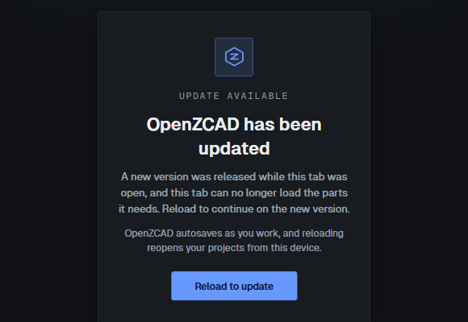
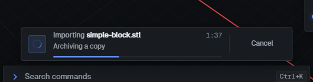
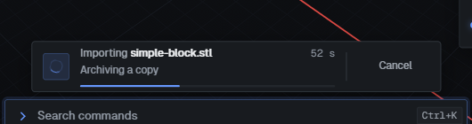
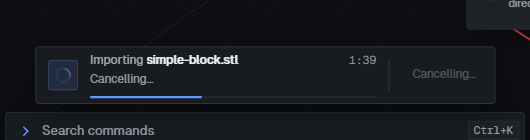
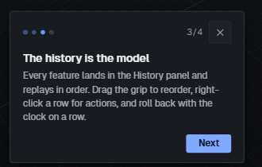
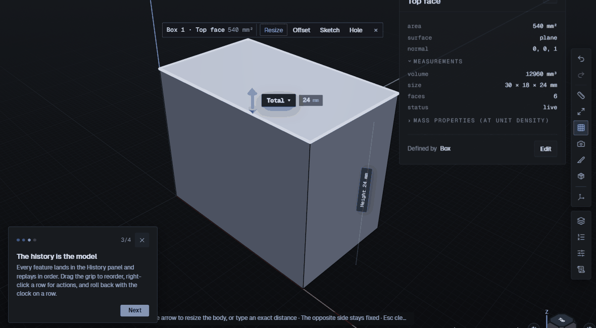

# Production QA in Microsoft Edge — 12 October 2026

**Three remaining findings: one P0 and two P3 under the supplied QA rubric.** All three findings from [PR #647](https://github.com/esaueng/OpenZCAD/pull/647) passed fresh production checks. This is a report-only rerun; no application code changed.

## Environment and build

| Field                            | Recorded value                                                                                                                                                                                                                                                                                          |
| -------------------------------- | ------------------------------------------------------------------------------------------------------------------------------------------------------------------------------------------------------------------------------------------------------------------------------------------------------- |
| Site                             | <https://zcad.app>                                                                                                                                                                                                                                                                                      |
| Production commit, start and end | `9113e9d0f8c4f6129e58a0f401833e84859f96bc`                                                                                                                                                                                                                                                              |
| Kernel                           | Remus `2026.1.52`, commit `b7d4c68f7468e8e9a5e51ed5f128fdde698699ec`                                                                                                                                                                                                                                    |
| Git comparison                   | Production matched fetched `origin/main`; no deployment observed during testing                                                                                                                                                                                                                         |
| Session                          | 12 October 2026, 05:22:42–06:28:51 UTC; concurrent modules, duration 66.2 minutes (01:22–02:28 EDT)                                                                                                                                                                                                     |
| Edge                             | Microsoft Edge `155.0.4283.45`; Chromium `155.0.8059.40`; `Edg/` and Microsoft Edge UA brands verified                                                                                                                                                                                                  |
| OS                               | Windows; UAData platform version `19.0.0`; exact Windows build not independently read                                                                                                                                                                                                                   |
| GPU                              | Intel UHD Graphics `0x00009BC4`, ANGLE Direct3D11, vs/ps 5.0                                                                                                                                                                                                                                            |
| Primary viewport                 | 1280×800 CSS px, DPR approximately 2; browser-reported screen 1280×800 in the isolated context                                                                                                                                                                                                          |
| Additional viewports             | 1920×1080, 1440×900, 1024×768, 768×1024, 390×844; DPR1 desktop spot checks                                                                                                                                                                                                                              |
| Themes and density               | Dark/light matrix; System with emulated light/dark OS; compact/comfortable drawer checks                                                                                                                                                                                                                |
| Driver A                         | Connected Microsoft Edge browser extension through the available computer-use browser adapter, own temporary tab, read-only start screen and hard reload. The specifically named Claude extension was unavailable. Existing profile appeared authenticated; no account/cloud action or project mutation |
| Driver A display                 | 1991×1034 viewport, 2048×1152 screen, DPR1.25; Edge UA version `155.0.0.0`                                                                                                                                                                                                                              |
| Driver B                         | Headed Playwright `channel: 'msedge'`, fresh isolated signed-out profiles; real controls, pointer picking and stepped drags. No production E2E hooks, seeded application state, API stubs or forced kernel outcomes                                                                                     |
| Edge preferences                 | Enhanced security, tracking prevention, efficiency/sleep settings and native page zoom could not be read. Settings navigation was rejected by the browser adapter's HTTP(S)-only policy; no bypass or browser setting change attempted                                                                  |
| Authentication                   | Driver B signed out, confirmed by `/api/session` 401; cloud and assistant opt-in absent                                                                                                                                                                                                                 |

Observers captured layout shifts, long tasks, CSP violations, console errors/warnings, page errors and failed requests. Driver A's read-only adapter did not permit installing those observers; the detailed instrumentation belongs to Driver B. Screenshots were visually reviewed, with lint candidates checked against actual pixels and controls. All committed images are fresh, signed-out crops under 300 KB.

## Summary

| Severity | Count |
| -------- | ----: |
| P0       |     1 |
| P1       |     0 |
| P2       |     0 |
| P3       |     2 |

Tags overlap: **functional 2, visual 2, copy 2, a11y 0, perf 0, edge-only 0**. No Chromium comparison was run, so none is called Edge-only. Each finding reproduced twice through independent attempts.

1. **EDGE-04, P0:** first opening History while offline replaces the entire workspace with a false update screen. Reconnecting alone does not recover it; online reload does. P0 follows the brief's explicit application-crash criterion. No browser-process crash or data loss was observed.
2. **EDGE-05, P3:** a successfully rendered STL import remains “Archiving a copy”; Cancel stays “Cancelling…” and carries into another project.
3. **EDGE-06, P3:** tour step 3 describes History while its target drawer is closed, leaving no target highlight.

These are all the confirmed findings, rather than five padded entries. Core plate/bracket modeling, constraints, exact refusal safeguards, file exchange and local save/reload worked in the tested cases. Production is substantially usable for local modeling, but the offline workspace failure interrupts the browser-first workflow, and stale progress and tour guidance weaken trust. The visual sweep found no additional repeatable overflow or overlap in its captured states. This is not a complete certification: native Edge security/InPrivate/hardware paths, opt-in services and the full every-tool visual cross-product remain limited below.

## Coverage matrix

“Passed” means the stated tested case passed. “Partial” identifies missing variants; a screenshot count is not a test count.

| Item                             | Result  | Evidence and boundary                                                                                                                                                                                                          |
| -------------------------------- | ------- | ------------------------------------------------------------------------------------------------------------------------------------------------------------------------------------------------------------------------------ |
| A1 Cold load, Driver B           | Passed  | Fresh signed-out start; enabled Create, workspace and WASM/kernel-driven model creation; console/network capture. Timing proxies below                                                                                         |
| A2 Cold load, Driver A           | Partial | Own connected Edge tab, start and hard reload; fonts loaded, no adapter console messages. Existing settings/extension causes not isolated                                                                                      |
| A3 First paint                   | Partial | Geist fonts loaded; cold CLS 0.00597. Page title OpenZCAD. No filmstrip/theme-flash measurement or independent favicon acceptance                                                                                              |
| A4 Start screen                  | Partial | Empty/populated at six sizes, both themes; five QA names including 40/200 characters. Three live demos. A one-character total name conflicts with the mandatory QA prefix                                                      |
| A5 Tour                          | Failed  | Four steps, real selection advances step 2, dismissal persists. EDGE-06 at step 3; dark only                                                                                                                                   |
| A6 Reload mid-work               | Passed  | Open tool card discarded with reopened-project notice; committed sketch/history restored after reload. No claim that an unfinished pointer gesture is durable                                                                  |
| B1 Plate                         | Passed  | 100×60×6, two Ø6 through holes at ±40, radius 7 refusal suggests 5.5, radius 3 succeeds; Undo/Redo; final 35467.57 mm³                                                                                                         |
| B2 Parametric bracket            | Passed  | Inline width=80; two boxes, Union, inside radius 3, expression-positioned holes; panel 120 then Tweak 60; six live features                                                                                                    |
| B3 Sketching                     | Passed  | XY/XZ/YZ and planar-face entry; line chain, arc, circle, rectangle, text; all 12 rail constraints and Solve; intentional conflict retains geometry                                                                             |
| B4 From sketch                   | Passed  | Add/Cut/negative Extrude, Revolve, ruled Loft, Sweep and Helical sweep; real Shift-click two-region extrusion                                                                                                                  |
| B5 Tool catalogue                | Partial | Every listed tool has valid/refused input, history and Undo/Redo evidence; Enter/Escape batches. Complete per-tool opening latency/preview/visual matrix not measured for every tool                                           |
| B6 Direct manipulation           | Partial | Five real stepped drags with Shift after start and Escape; exact chip entries commit. Handle-label readability at every zoom level not completed                                                                               |
| B7 History/parameters            | Passed  | Early edit, dependent suppression/deletion dialogs, rollback/resume, Undo restoration; requested expression matrix and inline definition. Invalid Shell-producing edit safely refused                                          |
| B8 Selection                     | Partial | Five Q filters; repeat-click stack cycling; two-body Shift toggle; window/crossing; body/edge double-click, context and Alt+Down; inside corner selected for bracket fillet. Long multi-edge smooth-chain case not established |
| B9 Viewport                      | Partial | Views, Fit, normal, grid/display/projection, stepped orbit/right/middle pan, pointer wheel, empty double-fit, widget, three section planes. Near/far clipping extremes not exhaustively swept                                  |
| B10 Modes                        | Passed  | View/Tweak/Build cycle; three Box measurements, Delete one, Escape stops; View keeps geometry locked                                                                                                                           |
| B11 Demos                        | Partial | All three shipped demos render, histories 17/10/7; each parameter edited/restored; used-feature suppression warns with dependents. Visual Selection Reference is E2E-only, absent from production by design                    |
| B12 Imports                      | Failed  | All 15 fixtures attempted, 11 accepted/four correctly refused; curved/void/inch/FCStd numeric checks; imported cube hole edit. EDGE-05 progress/cancel                                                                         |
| B13 Exports                      | Partial | All 14 authorized files completed and parsed; exact Plate/Bracket STEP and Plate backup round trips. Raw sketch DXF unavailable; supported planar-face outline proxy used                                                      |
| B14 Persistence/offline/two tabs | Failed  | Accepted immediate reload, normal close/reopen, offline commit/reconnect, two-tab edit lock pass. EDGE-04 when History's first lazy load occurs offline                                                                        |
| B15 Settings                     | Partial | All ten sections, six sizes/both themes; mutable General/Appearance/Viewport/Sketching values persist. Cloud/provider credentials and every snap/tolerance combination excluded                                                |
| B16 Commands                     | Passed  | Ctrl+K and /, plain words without assistant, tools/views/files, Go to feature, arrows, Tab completion, Enter, Escape                                                                                                           |
| B17 Shortcut reference           | Partial | All 59 rows accounted for below; Windows Ctrl bindings only. Pointer-chain and full Escape-ladder limits explicit                                                                                                              |
| B18 Keyboard-only                | Partial | Start/workspace/tool focus; Controls, Export and dependent Delete modal traps; Escape and focus return. Every dialog and full ladder not exhaustively traversed                                                                |
| B19 Abuse/races                  | Partial | Double Enter/Create, Undo during ghost, mid-sketch/mid-running-pattern switches, rapid tool changes, 50-copy progress/cancel. Escape mid-import observed, not advertised as cancellation; resize-during-drag not established   |
| B20 Performance feel             | Partial | Single-run timing/RAF/heap observations below; RAF is not GPU frame completion or a controlled performance benchmark                                                                                                           |
| B21 Cloud                        | Skipped | No opt-in QA account/approval; no sign-in, invites, cloud revisions, sharing or conflict mutations                                                                                                                             |
| B22 Assistant                    | Skipped | No configured-provider opt-in; no keys, prompts or assistant changes                                                                                                                                                           |
| C1 Enhanced security             | Blocked | Native settings inaccessible through adapter policy; current level and on/off comparison unknown                                                                                                                               |
| C2 Strict tracking prevention    | Blocked | Native settings unavailable; no Strict-mode/sign-in/Turnstile comparison                                                                                                                                                       |
| C3 Native InPrivate              | Blocked | No native InPrivate window exercised. Fresh Playwright contexts are not claimed as native InPrivate acceptance                                                                                                                 |
| C4 Page zoom                     | Partial | 50/80/110/125/150/200% viewport-size approximations, both themes, labeled as approximations; native zoom unchanged                                                                                                             |
| C5 Edge chrome                   | Partial | App context-menu behavior tested; narrowed viewports approximate sidebar space. Native sidebar, autofill, mini menu, translation prompts and native overlay scrollbar interactions not established                             |
| C6 Contrast/motion               | Partial | Forced colors, increased contrast and reduced motion with selection/drawer in both themes; controls outlined; transitions 0.01 ms. Representative states                                                                       |
| C7 Sleeping/background tab       | Partial | Actual 311818 ms background interval; returned model/context/tool usable. No proof Edge slept/discarded it; efficiency preference unknown                                                                                      |
| C8 Physical trackpad             | Blocked | No physical trackpad input available; Playwright wheel/mouse is not hardware evidence                                                                                                                                          |

## Modeling and file evidence

| Tool             | Valid / invalid                                               | Enter / Escape                                                                                               | Undo / Redo                                                         | Result mm3; bbox mm; faces                   |
| ---------------- | ------------------------------------------------------------- | ------------------------------------------------------------------------------------------------------------ | ------------------------------------------------------------------- | -------------------------------------------- |
| Box              | passed                                                        | passed / passed; no feature added                                                                            | exact rendered Properties text match                                | 12960 mm³; 30 × 18 × 24 mm; 6                |
| Chamfer          | passed                                                        | passed in focused Name field / passed; identical feature/body counts                                         | exact rendered Properties and summary match                         | 12426.67 mm³; 30 × 18 × 24 mm; 26            |
| Circular pattern | passed                                                        | not separately repeated / card Escape not separately repeated; explicit Cancel pattern passed                | 4-copy exact Properties; after50-cancel source undo1/redo2 features | 51840 mm³; 260 × 260 × 24 mm; 24             |
| Cone             | passed                                                        | passed / passed; no feature added                                                                            | exact rendered Properties text match                                | 1524.72 mm³; 12 × 12 × 28 mm; 3              |
| Cylinder         | passed                                                        | passed / passed; no feature added                                                                            | exact rendered Properties text match                                | 3166.73 mm³; 12 × 12 × 28 mm; 3              |
| Draft            | passed                                                        | passed in focused Name field / passed; identical feature/body counts                                         | exact rendered Properties and summary match                         | 13412.8 mm³; 30 × 19.258 × 24 mm; 6          |
| Extrude          | passed                                                        | passed negative-distance creation / passed light preview cancel; root direct-drag cancel separately          | cut and advanced-body recreation round-trip                         | —                                            |
| Fillet           | passed                                                        | passed / not independently repeated here; root B6 owns drag cancel                                           | Plate radius3 round-trip passed                                     | 35467.57 mm³; 100 × 60 × 6 mm; 9             |
| Grid pattern     | passed                                                        | passed in focused Name field / passed; identical feature/body counts                                         | exact rendered Properties and summary match                         | 64800 mm³; 50 × 58 × 24 mm; 18               |
| Helical sweep    | passed                                                        | passed in Name field / passed; no canonical change                                                           | exact rendered Properties match                                     | 387.62 mm³; 21.975 × 21.951 × 17.97 mm; 1190 |
| Hole             | passed                                                        | passed single-step create / not separately repeated                                                          | not independently repeated here                                     | —                                            |
| Intersect        | passed                                                        | passed in focused Name field / passed; identical feature/body counts                                         | exact rendered Properties and summary match                         | 678.58 mm³; 6 × 6 × 24 mm; 5                 |
| Linear pattern   | passed                                                        | passed in focused Name field / passed; identical feature/body counts                                         | exact rendered Properties and summary match                         | 30240 mm³; 70 × 18 × 24 mm; 6                |
| Loft             | passed                                                        | passed in Name field / passed; no canonical change                                                           | exact rendered Properties match                                     | 5497.79 mm³; 20 × 20 × 30 mm; 3              |
| Mirror           | passed                                                        | passed in focused Name field / passed; identical feature/body counts                                         | exact rendered Properties and summary match                         | 12960 mm³; 30 × 18 × 24 mm; 6                |
| Move             | X5 valid; nonfinite entry normalized to no-op, Apply disabled | Enter applies X5; stepped drag Escape restores                                                               | feature count 3→4→3→4                                               | translation; dimensions unchanged            |
| Revolve          | passed                                                        | passed in Name field / passed; no canonical change                                                           | exact rendered Properties match                                     | 3158.27 mm³; 28 × 8 × 28 mm; 1               |
| Scale            | passed                                                        | passed in focused Name field / passed; identical feature/body counts                                         | exact rendered Properties and summary match                         | 103680 mm³; 60 × 36 × 48 mm; 6               |
| Shell            | passed                                                        | passed in focused Name field / passed; identical feature/body counts                                         | exact rendered Properties and summary match                         | 4952 mm³; 30 × 18 × 24 mm; 11                |
| Sketch           | passed                                                        | interactive draw/Finish path; numeric editor Apply tested / draw-chain Escape and invalid edit cancel passed | numeric edit restored radius5; no body Props for sketch             | —                                            |
| Solid offset     | passed                                                        | passed in focused Name field / passed; identical feature/body counts                                         | exact rendered Properties and summary match                         | 16640 mm³; 32 × 20 × 26 mm; 6                |
| Sphere           | passed                                                        | passed / passed; no feature added                                                                            | exact rendered Properties text match                                | 904.78 mm³; 12 × 12 × 12 mm; 2               |
| Split            | passed                                                        | passed in focused Name field / passed; identical feature/body counts                                         | exact rendered Properties and summary match                         | 6480 mm³; 15 × 18 × 24 mm; 6                 |
| Subtract         | passed                                                        | passed in focused Name field / passed; identical feature/body counts                                         | exact rendered Properties and summary match                         | 12281.42 mm³; 30 × 18 × 24 mm; 7             |
| Sweep            | passed                                                        | passed in Name field / passed; no canonical change                                                           | exact rendered Properties match                                     | 848.23 mm³; 6 × 6 × 30 mm; 3                 |
| Thicken          | passed                                                        | passed in focused Name field / passed; identical feature/body counts                                         | exact rendered Properties and summary match                         | original 12960; new wall 1080 mm³, 30×18×2   |
| Torus            | passed                                                        | passed / passed; no feature added                                                                            | exact rendered Properties text match                                | 473.74 mm³; 16 × 16 × 4 mm; 1                |
| Union            | passed                                                        | passed after body list picks / not separately repeated                                                       | not independently repeated here                                     | —                                            |

Interaction counts: Plate **12 clicks, seven Enters, 11 model-field input events**, one intentional fillet refusal plus zero-diameter validation, no dead end. Bracket **14 clicks, 13 actual Enters (12 captured by the bubbling listener), 14 model-field input events**, one intentional incomplete-Union validation, no dead end. Search/project-name inputs and later Properties inspections are excluded. The 11 October review counted 62 clicks, 20 typed fields and ten Enters for its bracket journey; the definitions and automation differ, so these are not a like-for-like speed improvement. Warm tool-opening samples cover 23 tools, not every tool.

Valid/refused inputs do not imply every keyboard/round-trip subcase was separately repeated. Hole/Union independent Undo/Redo and Circular card Enter/Escape remain limited. Mirror/Split numeric readouts inspect the first body; Thicken independently verified the original and new body. Helical Diagnostics explicitly labels the faceted approximation, straight path steps/chords and the 1190 faces used for mass/export.

The plate finishes at **35467.57 mm³, 100×60×6 mm, nine faces, four features**. The bracket at width 120 is **44949.03 mm³**; at width 60 it is **22333.14 mm³, 60×40×40 mm, 11 faces, six features**. Both were independently rebuilt by modeling and file-exchange modules.

All 12 constraints were exercised: Horizontal, Vertical, Parallel, Perpendicular, Equal, Tangent, Concentric, Coincident, Midpoint, Radius, Distance and Angle. Tangent/Concentric/Midpoint Solve moved geometry; already satisfied constraints reported that state. Intentional Horizontal+Vertical+Distance overconstraint reported “Constraints conflict” and retained geometry. The historical QA-008 collapse fixture itself was not replayed.

Early hollow-loft edit: upper section width 40→30 would invalidate Shell. Apply refused with “A selected face no longer exists. Re-select…” and “Edit not saved · Shell”; the previous **12630.86 mm³, 60×40×40 mm, ten-face** hollow model remained. Dependent suppression named Loft/Shell, rollback exposed the **61333.33 mm³** precursor only while deliberately rolled back, and resume/Undo restored the hollow result. This verifies the application safeguard, not a repaired kernel operation.

Expressions: `10 in` and `width/2` accepted; `10 in` committed a 254 mm width. `1e9` and `1e-6` were accepted input/preview cases, not claims that extreme geometry was saved. Unknown identifier, `0`, negative `-3`, `2,5`, empty and unicode identifier were refused. No assertion is made about all inch-project mixed-unit expressions.

Direct drags used at least 20 intermediate moves, then Shift after the drag began. Observed preview→Escape values: **face offset +4.49→0 mm; fillet R5.25→0; chamfer C5.25→0; Extrude +13.39→0**. Move X reached **5.52 mm** and Escape cancelled to the unchanged Box. Exact radius 2 and face offset 2 committed and Undo restored the original model. Initial coordinate misses and a crossing attempt begun on a live resize handle were excluded and rerun from empty canvas.

| Fixture                                                     | Outcome                     | Rendered Properties / limit                                                                                                                                                                         |
| ----------------------------------------------------------- | --------------------------- | --------------------------------------------------------------------------------------------------------------------------------------------------------------------------------------------------- |
| `samples/simple-block.stl`                                  | PASS_GEOMETRY_FAIL_PROGRESS | 0 mm³ / 20×20×0 mm / 2 faces. Two-triangle open quad; zero volume is correct. EDGE-05 archive/cancel progress remains active.                                                                       |
| `samples/simple-assembly.step`                              | FIXTURE_LIMITATION          | Refused; no body/history added. Fixture contains metadata but no solid representation. Correctly refused: STEP file contains no solids. Positive assembly coverage uses FCStd and multi-solid STEP. |
| `samples/parametric-bracket.step`                           | PASS                        | 17491.92 mm³ / 60×24×30 mm / 14 faces. Accepted; settled Properties and rendered geometry inspected.                                                                                                |
| `test/fixtures/mesh-import/box.obj`                         | PASS                        | 24 mm³ / 2×3×4 mm / 6 faces. Accepted; settled Properties and rendered geometry inspected.                                                                                                          |
| `test/fixtures/mesh-import/box.ply`                         | PASS                        | 24 mm³ / 2×3×4 mm / 6 faces. Accepted; settled Properties and rendered geometry inspected.                                                                                                          |
| `test/fixtures/freecad/two-solids.FCStd`                    | PASS                        | 6000 mm³ / 10×20×30 mm / 6 faces; 480 mm³ / 5×8×12 mm / 6 faces. Two saved solids; UI clearly states sketches/history are not transferred and converted geometry remains local.                     |
| `test/fixtures/step/lemon-torus-band.step`                  | PASS                        | 137.12 mm³ / 6×6×6 mm / 3 faces. Accepted; settled Properties and rendered geometry inspected.                                                                                                      |
| `test/fixtures/step/nurbs-trimmed-cylinder.step`            | PASS                        | 240.64 mm³ / 4×8×10 mm / 5 faces. Accepted; settled Properties and rendered geometry inspected.                                                                                                     |
| `test/parity/corpus/b-unit-inch-cube.step`                  | PASS                        | 16387.06 mm³ / 25.4×25.4×25.4 mm / 6 faces. Accepted; settled Properties and rendered geometry inspected.                                                                                           |
| `test/parity/corpus/c-void-two-cavities.step`               | PASS                        | 11272 mm³ / 30×20×20 mm / 18 faces. Accepted; settled Properties and rendered geometry inspected.                                                                                                   |
| `test/parity/corpus/d-multi-solid-and-void.step`            | PASS                        | 7000 mm³ / 20×20×20 mm / 12 faces; 216 mm³ / 6×6×6 mm / 6 faces. Accepted; settled Properties and rendered geometry inspected.                                                                      |
| `test/parity/corpus/f-hostile-open-shell.step`              | EXPECTED_REFUSAL            | Refused; no body/history added. Open shell refused with single-face-edge/no-enclosed-volume diagnostic; no history/body added.                                                                      |
| `test/parity/corpus/f-hostile-dangling-reference.step`      | EXPECTED_REFUSAL            | Refused; no body/history added. Fresh STEP export guidance plus raw Activity diagnostic: parse error: entity #999999 not found.                                                                     |
| `test/parity/corpus/f-hostile-no-shape-representation.step` | EXPECTED_REFUSAL            | Refused; no body/history added. STEP file contains no solids; no history/body added.                                                                                                                |
| `test/fixtures/hammer-holder/synthetic-holder.step`         | PASS                        | 16426.67 mm³ / 60×32×20 mm / 21 faces. Accepted; settled Properties and rendered geometry inspected.                                                                                                |

The inch cube bounds were **25.4³ mm**. A centered Ø6 through hole changed **16387.06→15668.9 mm³**, six→seven faces and one→two features, retaining bounds. FreeCAD conversion produced both expected volumes **480 and 6000 mm³**, with honest geometry-only/local-only notices and no CSP violation.

Exports: Plate and Bracket each produced STEP, binary STL, ASCII STL, 3MF, OBJ and GLB; Plate additionally produced `.openzcad`; `QA-Sketch.dxf` used the supported face-outline route. All files were nonempty and parsed independently: STEP entities/terminator, STL encoding/count/bounds, 3MF ZIP CRC/XML/mm units, OBJ coordinates, GLB magic/version/length/0.001 scale/Z-up→Y-up parent transform, and backup JSON v1. Tessellated mesh volume is not equated to exact BRep volume. Literal raw-sketch DXF was unavailable; the proxy contains four LINE entities, millimeter units and 28×18 mm bounds.

| Round trip                 | Volume mm³ | Bounds mm | Faces | Features |
| -------------------------- | ---------: | --------- | ----: | -------: |
| Plate original             |   35467.57 | 100×60×6  |     9 |        4 |
| Plate STEP                 |   35467.57 | 100×60×6  |     9 |        1 |
| Plate backup               |   35467.57 | 100×60×6  |     9 |        4 |
| Bracket original, width 60 |   22333.14 | 60×40×40  |    11 |        6 |
| Bracket STEP               |   22333.14 | 60×40×40  |    11 |        1 |

Accepted Box+Sphere edits survived immediate real reload and normal tab close/reopen. An offline Sphere commit survived reconnect/reload. A second tab on the same project visibly explained the edit lock and disabled editing. Pending-save native departure warnings were respected; no force-close bypass was used.

## Visual matrix

V1–V6 = 1920×1080, 1440×900, 1280×800, 1024×768, 768×1024, 390×844 CSSpx. Z1–Z6 = 2560×1600, 1600×1000, 1164×727, 1024×640, 853×533, 640×400 CSSpx (viewport-size zoom approximation). Missing per-capture density metadata inherits the compact primary context.

| State family                                          | Result          | Captures | Viewport(s) CSSpx | Theme(s)                   | Density / DPR               | Evidence or limit                                                                                                                                |
| ----------------------------------------------------- | --------------- | -------: | ----------------- | -------------------------- | --------------------------- | ------------------------------------------------------------------------------------------------------------------------------------------------ |
| Start: empty                                          | Passed          |       12 | V1–V6             | dark / light               | compact; DPR2               | Three production demos named; empty start inspected.                                                                                             |
| Start: populated                                      | Passed          |       12 | V1–V6             | dark / light               | compact; DPR2               | Five QA documents; 17-, 40- and 200-character names. Expected ellipsis retains full names.                                                       |
| Workspace: empty                                      | Passed          |       12 | V1–V6             | dark / light               | compact; DPR2               | Real new projects, fonts loaded; no seeded app state.                                                                                            |
| Settings: General                                     | Passed          |       12 | V1–V6             | dark / light               | compact; DPR2               | Section inspected at all six sizes; mutation/reload coverage is separately limited below.                                                        |
| Settings: Appearance                                  | Passed          |       12 | V1–V6             | dark / light               | compact; DPR2               | Section inspected at all six sizes; mutation/reload coverage is separately limited below.                                                        |
| Settings: Shortcuts                                   | Passed          |       12 | V1–V6             | dark / light               | compact; DPR2               | Section inspected at all six sizes; mutation/reload coverage is separately limited below.                                                        |
| Settings: Viewport                                    | Passed          |       12 | V1–V6             | dark / light               | compact; DPR2               | Section inspected at all six sizes; mutation/reload coverage is separately limited below.                                                        |
| Settings: Sketching                                   | Passed          |       12 | V1–V6             | dark / light               | compact; DPR2               | Section inspected at all six sizes; mutation/reload coverage is separately limited below.                                                        |
| Settings: Files & autosave                            | Passed          |       12 | V1–V6             | dark / light               | compact; DPR2               | Section inspected at all six sizes; mutation/reload coverage is separately limited below.                                                        |
| Settings: Account                                     | Passed          |       12 | V1–V6             | dark / light               | compact; DPR2               | Signed-out visual state; account/provider setup excluded.                                                                                        |
| Settings: AI Assistant                                | Passed          |       12 | V1–V6             | dark / light               | compact; DPR2               | Signed-out visual state; account/provider setup excluded.                                                                                        |
| Settings: Privacy & data                              | Passed          |       12 | V1–V6             | dark / light               | compact; DPR2               | Section inspected at all six sizes; mutation/reload coverage is separately limited below.                                                        |
| Settings: Advanced                                    | Passed          |       12 | V1–V6             | dark / light               | compact; DPR2               | Section inspected at all six sizes; mutation/reload coverage is separately limited below.                                                        |
| Box: valid form                                       | Passed          |       12 | V1–V6             | dark / light               | compact; DPR2               | Full tool-card matrix covers Box only.                                                                                                           |
| Box: refusal form                                     | Passed          |       12 | V1–V6             | dark / light               | compact; DPR2               | Invalid Box input and refusal guidance; full six-size matrix.                                                                                    |
| Workspace tour: steps 1–4 + independent step-3 repeat | Failed: EDGE-06 |        5 | 1280×800          | dark                       | compact (context); DPR2     | EDGE-06 reproduced twice: History step points at a closed drawer. Dark only.                                                                     |
| Keyboard focus: start/workspace/tool                  | Passed          |        3 | 1280×800          | light / dark               | compact (context); DPR2     | One light workspace frame was initially mislabeled start; corrected start and dark Box focus frames retained.                                    |
| Controls / shortcut reference                         | Passed          |        3 | 1280×800          | light / dark               | compact (context); DPR2     | Initial light + final dark/light; actual ? key, focus trap, Escape and focus return verified.                                                    |
| Commands: Go to feature                               | Passed          |        2 | 1280×800          | dark / light               | compact (context); DPR2     | Go to QA feature 20 visible in dark/light; Enter behavior also exercised.                                                                        |
| Drawer disclosure targets                             | Passed          |        8 | 1280×800, 390×844 | dark / light               | compact / comfortable; DPR2 | 8 cases; 32 headers at least 24 CSSpx, nine-point ownership, no overlaps, real top/bottom-edge toggles.                                          |
| System theme and density                              | Passed          |        4 | 1280×800          | system-dark / system-light | compact / comfortable; DPR2 | OS dark/light emulated with System selected, in both densities; colors followed the OS scheme.                                                   |
| Export dialog                                         | Passed          |        1 | 1280×800          | dark                       | compact (context); DPR2     | Dark representative dialog; 24 Tab cycles remain within dialog, Escape closes.                                                                   |
| Sketch: six modes + closed rectangle                  | Passed          |        7 | 1280×800          | dark                       | compact (context); DPR2     | Select/Line/Arc/Circle/Rectangle/Text shortcuts and a real closed profile; dark only.                                                            |
| Extrude: valid/refusal forms                          | Passed          |        2 | 1280×800          | dark                       | compact (context); DPR2     | Representative closed-profile form captures; dark desktop only.                                                                                  |
| Page zoom approximation                               | Partial         |       12 | Z1–Z6             | dark / light               | compact; DPR2               | 50/80/110/125/150/200% approximated with CSS viewport size at DPR2. Native Edge zoom unchanged.                                                  |
| Forced colors                                         | Passed          |        2 | 1280×800          | dark / light               | compact; DPR2               | Visible controls and selection remain outlined.                                                                                                  |
| Increased contrast                                    | Passed          |        2 | 1280×800          | dark / light               | compact; DPR2               | Selection and drawer inspected; representative state only.                                                                                       |
| Reduced motion                                        | Passed          |        2 | 1280×800          | dark / light               | compact; DPR2               | Measured transition durations 0.01ms; representative state only.                                                                                 |
| View shortcuts: early frames                          | Partial         |        5 | 1280×800          | light                      | compact (context); DPR2     | Diagnostic captures taken before camera settling. Use the settled frames below for visual pass evidence.                                         |
| View shortcuts: settled Front/Top/Right/Iso/Fit       | Passed          |       10 | 1280×800          | dark / light               | compact (context); DPR2     | 800ms settle before capture; 20-body model in both themes.                                                                                       |
| Measure shortcut                                      | Passed          |        1 | 1280×800          | light                      | compact (context); DPR2     | M enters Measure in View mode; saved measurement deletion not exercised.                                                                         |
| Heavy History: initial 20-body frame                  | Passed          |        2 | 1280×800          | dark / light               | compact; DPR2               | 20 Box bodies produce 39 history steps including placement; initial combined drawer state.                                                       |
| Heavy History: dedicated top                          | Passed          |        2 | 1280×800          | dark / light               | compact; DPR2               | Dedicated History view with 39 steps, long names and intact header.                                                                              |
| Heavy History: dedicated bottom                       | Passed          |        2 | 1280×800          | dark / light               | compact; DPR2               | Scrolled to final history entries; intact header.                                                                                                |
| Parameters: 10 long names                             | Passed          |        2 | 1280×800          | dark / light               | compact; DPR2               | Initial screenshots have intact header; full title/accessible names retained with ellipsis.                                                      |
| Parameters: dedicated follow-up                       | Partial         |        2 | 1280×800          | dark / light               | compact; DPR2               | Header partly above viewport after prior scrolling; capture-flow caveat, not an independently reproduced product finding. Prefer initial frames. |
| DPR1: start                                           | Passed          |        2 | 1280×800          | dark / light               | compact; DPR1               | Separate fresh context; fonts loaded, measured DPR1.                                                                                             |
| DPR1: empty workspace                                 | Passed          |        1 | 1280×800          | light                      | compact; DPR1               | Light spot check only.                                                                                                                           |
| DPR1: Box                                             | Passed          |        2 | 1280×800          | light / dark               | compact; DPR1               | Dark/light spot checks, desktop only.                                                                                                            |
| DPR1: Appearance settings                             | Passed          |        2 | 1280×800          | dark / light               | compact; DPR1               | Dark/light spot checks, desktop only.                                                                                                            |
| Normal-to-face: initial attempt                       | Partial         |        1 | 1280×800          | light                      | compact (context); DPR2     | Diagnostic attempt selected an edge; superseded by actual planar-face verification below.                                                        |
| Normal-to-face: selected planar face                  | Passed          |        1 | 1280×800          | light                      | compact (context); DPR2     | Space aligned the selected Right face and framed it; light desktop.                                                                              |
| Stacked targets: initial attempt                      | Partial         |        1 | 1280×800          | light                      | compact (context); DPR2     | Initial pointer location missed the target; diagnostic frame retained.                                                                           |
| Stacked targets: successful list and Fit follow-up    | Passed          |        2 | 1280×800          | light                      | compact (context); DPR2     | Alt+Down showed two face targets; Fit follow-up camera was still gliding at capture. DOM/list interaction supplies the verification.             |
| Delete dependent confirmation                         | Passed          |        1 | 1280×800          | light                      | compact (context); DPR2     | Delete and Backspace exercised on a selected history feature; 12 Tab cycles trapped, Escape cancels.                                             |
| **Total (45 groups)**                                 | Accounting only |  **272** |                   |                            |                             | Every normalized capture assigned exactly once.                                                                                                  |

No captured state showed horizontal document overflow or unnamed visible controls. Automated lint candidates were reviewed: closed File-menu descendants explain occlusion, long names intentionally ellipsize with full accessible names/title, and cube/axis contrast reports used the wrong background for SVG over the dark viewport. The logo has an 18px border box with a 24px pseudo-element hit area; interior extension points were hit-tested. These are not new findings.

Additional modeling checkpoints: **174** private PNG states, dark primary with selected light Torus/Extrude/Revolve/Loft/Sweep/Helical cards and settled bracket/hollow models; all are representative 1280×800 DPR2 coverage. File and root modules add import/Properties/export/error/measurement/section/handle checkpoints. They are not counted in the 272-state visual-module total. Uncaptured state×viewport×theme combinations remain untested.

## Findings

### EDGE-04 — offline first-open History crashes the workspace into a false update screen

**P0 · functional, copy · New · hands-on · 2/2 independent fresh contexts.** Edge 155.0.4283.45, Windows, 1280×800, DPR2, dark, signed out, unchanged production SHA. P0 uses the supplied rubric's explicit crash criterion; this is an application workspace failure, not a browser-process crash. No data loss was observed.

1. In a fresh profile, create a QA project and a default Box. Wait for one feature/body and “Local only”; never open History.
2. Disconnect the real browser context from the network; verify `navigator.onLine === false`.
3. Open History.
4. Reconnect. Observe the failure persists; reload online to recover.

**Expected:** keep the usable offline workspace, explain that the panel has not been downloaded, and allow a retry when online. **Actual:** the entire workspace is replaced by “OpenZCAD has been updated” and “A new version was released while this tab was open.” Reconnection alone does not recover; online reload restores the identical saved one-Box model.



Relevant diagnostic, both trials:

```text
assets/Sidebar-DYpPZK2T.js  net::ERR_INTERNET_DISCONNECTED
assets/ParameterRows-BnVdx5zm.js  net::ERR_INTERNET_DISCONNECTED
TypeError: Failed to fetch dynamically imported module
OpenZCAD workspace crashed
```

The start/end metadata stayed identical, ruling out an actual deployment. Verified cause: [staleChunk.ts:12–24](https://github.com/esaueng/OpenZCAD/blob/9113e9d0f8c4f6129e58a0f401833e84859f96bc/apps/web/src/lib/staleChunk.ts#L12) classifies a failed dynamic import as stale without distinguishing offline failure; [ErrorBoundary.tsx:34](https://github.com/esaueng/OpenZCAD/blob/9113e9d0f8c4f6129e58a0f401833e84859f96bc/apps/web/src/components/ErrorBoundary.tsx#L34) selects update mode and [line 93](https://github.com/esaueng/OpenZCAD/blob/9113e9d0f8c4f6129e58a0f401833e84859f96bc/apps/web/src/components/ErrorBoundary.tsx#L93) supplies the false update heading. The lazy drawer wrapper at [App.tsx:796](https://github.com/esaueng/OpenZCAD/blob/9113e9d0f8c4f6129e58a0f401833e84859f96bc/apps/web/src/App.tsx#L796) has Suspense but no local error boundary in that wrapper. An earlier exploratory attempt reached the same page fallback through the separate FeatureHistoryPanel chunk; the two independent fresh-context repetitions above failed on Sidebar/ParameterRows. Related historical F6 concerns a real mid-deployment chunk change; that trigger was not replayed and this distinct offline trigger is a new discovery.

### EDGE-05 — STL archive/cancel progress persists into another project

**P3 · functional, visual · New · hands-on · 2/2 fresh projects.** Same production/Edge/Windows/DPR2 environment; signed out.

1. Import `samples/simple-block.stl` through the file input in a new QA project.
2. Wait for its surface to render and local save to settle.
3. Observe “Archiving a copy” still active at **1:37**; independent repeat at **52 seconds**.
4. Click Cancel, navigate Home, create a new QA Plate and model it.

**Expected:** progress settles after completion or cancellation and remains scoped to its project. **Actual:** a disabled “Cancelling…” persists in the new project with the pill timer displaying **1:39**, well over ten seconds after cancellation. Modeling and saving still work; a later transfer replaces the pill. The fixture is an open two-triangle 20×20 mm surface, so zero volume is correct and separate from this finding. No source-level cause established.






### EDGE-06 — History tour step has no visible target

**P3 · visual, copy · New · hands-on · 2/2 fresh contexts.** Same production/Edge/Windows environment, 1280×800 dark, DPR2; signed out.

1. Create the first QA project in a fresh profile.
2. Create a Box in step 1; advance “Select to edit” by a real face click or Next.
3. Observe step 3, “The history is the model,” while the drawer remains closed.

**Expected:** open the History drawer or highlight its visible rail control. **Actual:** the text describes History row actions, but there is no `.sidebar` and no `.tour-target`; nothing is highlighted. Next/Finish remain usable and dismissal persists after reload.




Verified cause: the step's [workspaceTour.ts:55](https://github.com/esaueng/OpenZCAD/blob/9113e9d0f8c4f6129e58a0f401833e84859f96bc/apps/web/src/lib/workspaceTour.ts#L55) selector is `.sidebar`; [WorkspaceTour.tsx:89–111](https://github.com/esaueng/OpenZCAD/blob/9113e9d0f8c4f6129e58a0f401833e84859f96bc/apps/web/src/components/WorkspaceTour.tsx#L89) queries and marks the target but does not open the drawer.

## Prior-findings status

| Prior ID                                   | Current status                                                           | Actual rerun evidence and boundary                                                                                                                                                                                                                                          |
| ------------------------------------------ | ------------------------------------------------------------------------ | --------------------------------------------------------------------------------------------------------------------------------------------------------------------------------------------------------------------------------------------------------------------------- |
| F1 — parameter resize                      | **PASS**                                                                 | Both modeling and file modules built Box+Box+Union+Fillet+Hole+Hole, width 80→120→60. At 120: 44949.03 mm³ / 120×40×40; at 60: 22333.14 mm³ / 60×40×40; all six features live                                                                                               |
| F2 — dependent delete silent               | **PASS in tested dependent branch**                                      | Delete Upper duct section names Loft and Shell; deletion changes four features to three and Undo restores the branch. Visual module separately tested Delete/Backspace dependent confirmation and Escape                                                                    |
| F3 / G7 — Hole position/axes               | **PASS in tested top-face workflow**                                     | Real face click sets V=3/U=0; V along +X appears first and U along −Y second; ghost visible; ±40 positions built correctly                                                                                                                                                  |
| F4 — Enter toggles Union pick              | **PASS**                                                                 | Select Box 1 and Box 2 in list, then Enter commits Union                                                                                                                                                                                                                    |
| F5 — stale command across project          | **PASS for tested modeling drafts; related transfer finding remains**    | Mid-sketch and running-pattern switches preserve each project's own history; destination has its own Box, no pattern/draft leakage. This does not cover every old Fillet-chip scenario. EDGE-05 concerns active file-transfer UI, not the original modeling-command trigger |
| F6 — mid-deploy dynamic import             | **Original trigger NOT RETESTED; related new EDGE-04**                   | No deploy occurred during the rerun. Going offline before first History load crashes into misleading “new version released” UI on unchanged build, twice. Keep offline trigger separate from original mid-deploy finding                                                    |
| F7 — fillet hint/preview                   | **PARTIAL PASS**                                                         | Radius 7 on 6 mm plate refused with usable radius 5.5 suggestion; radius 3 works. Old edited-radius R3→R5 boundary and dishonest preview were not exactly retested                                                                                                          |
| F14 — two-step Hole create                 | **PASS**                                                                 | One Enter commits each valid Hole; diameter 0 disabled with actionable positive-value guidance                                                                                                                                                                              |
| F18 / G9 — names                           | **PASS in tested bracket surfaces**                                      | Union 1, Hole / Hole 2, Box 1 / Box 2 and Top face names consistent across tested cards/body/history. Do not claim every topology or persisted old document naming case                                                                                                     |
| F20 / G1 — suppress branch feedback        | **PASS**                                                                 | Upper duct section suppress dialog names Loft and Shell and offers Suppress them too; branch pauses and Undo restores 12630.86 mm³ / 10 faces. Root demos separately name Boss's six dependents, Rim profile's four, Base profile's three                                   |
| F24 — question key                         | **Actual behavior PASS; prior harness ambiguity resolved**               | Real `?` opens Controls; Escape/focus return verified. Shift+/ initially entered slash and was corrected in harness. Do not assert a new product fix from that harness correction                                                                                           |
| F25 — System theme                         | **PASS in tested OS emulation**                                          | System follows dark/light OS emulation in compact and comfortable density                                                                                                                                                                                                   |
| G4 / G13 — plain search / duplicate Fillet | **PASS**                                                                 | Signed out, plain `fil` searches commands and Enter opens Fillet; one Fillet result. Import CAD files is a distinct action. Visual report and shortcut evidence.                                                                                                            |
| G5 — inline parameter definition           | **PASS**                                                                 | Box Width=`width` offers Value for new parameter width=80 and creates parameter with the feature. Both modeling/file bracket recipes use this                                                                                                                               |
| G6 — primitive ghost                       | **PASS for tested Box ghost**                                            | Real primitive ghost screenshot state exists while dimensions resolve before Create. Do not claim every primitive/field/viewport combination. Modeling primitive screenshots; visual Box matrix.                                                                            |
| G10 — History menu actions                 | **PASS for tested row menu**                                             | Upper duct section More actions contains Rename, Suppress, Roll back and Delete                                                                                                                                                                                             |
| G14 drawer portion / EDGE-02               | **PASS for four drawer disclosures**                                     | 1280/390 × dark/light × compact/comfortable: 32 measured boxes ≥24 CSS px, nine points each, zero overlaps and both-edge toggles. Cube corners/parameter names and all other old G14 targets not claimed                                                                    |
| EDGE-01 — malformed STEP copy              | **PASS**                                                                 | Three malformed uploads in two fresh projects; fresh-export guidance and raw #999999 Activity diagnostic; canonical orders/version unchanged; Undo/Redo seed preserved                                                                                                      |
| EDGE-03 — accepted edit durability         | **PASS for root tested signed-out reload/departure flow**                | Local persisted edits survive real reload; pending writes trigger native beforeunload warning and cancellation retains workspace. Fresh real reload/departure checks, not only PR provenance                                                                                |
| QA-001 — FreeCAD CSP                       | **PASS**                                                                 | Actual FCStd conversion yields 6000 and 480 mm³, two solids; no CSP/pageerror/requestfailure; no protected uploads. Geometry-only/local-only notices honest                                                                                                                 |
| QA-002 — sketch survives project creation  | **PASS in tested project-switch races**                                  | Switch mid-sketch then create destination Box; source sketch stays source-owned. Switch during actual running 50-copy pattern; destination remains its one Box and source retains two baseline features, no Pattern leak                                                    |
| QA-003 — analytics blocked                 | **No recurrence in observed requests; policy not exhaustively retested** | File module recorded two successful-path Cloudflare RUM POSTs and zero CSP violations; this is runtime observation, not a fresh exhaustive CSP-policy review                                                                                                                |
| QA-007 — dense circular progress/cancel    | **PASS for progress/cancel safety; no portable latency claim**           | Visible elapsed time and Cancel pattern; fresh repeat cancelled at 217 ms, retained two baseline features and 12960 mm³ source, Undo→1 / Redo→2. Earlier delayed Cancel completed before click, retained as diagnostic rather than cancellation proof                       |
| QA-008 — perpendicular collapse            | **Exact historical fixture NOT RETESTED**                                | Valid perpendicular Solve and intentional Horizontal+Vertical+Distance conflict exercised; conflict preserved geometry. This is related coverage only, not proof that the old collapse reproduction passed                                                                  |
| CAD-002 — upstream hollow-loft Shell       | **SAFE REFUSAL / application safeguard PASS; kernel fix NOT CLAIMED**    | Real UI upper-section 40→30 edit refuses, keeps original 12630.86 mm³ / 10-face model and offers repair guidance                                                                                                                                                            |

Delivery provenance was checked: [#610](https://github.com/esaueng/OpenZCAD/pull/610), [#644](https://github.com/esaueng/OpenZCAD/pull/644) and [#647](https://github.com/esaueng/OpenZCAD/pull/647) are merged. Source PRs #628–643 were closed without individual merges; #644 incorporated their changes. A merged PR is provenance, not acceptance evidence.

Untouched exact historical triggers remain unverified: F8–F13, F15–F17, F19, F21–F23, F26–F30; complete G2/G3/G8/G11/G12/G15/G16; QA-004/005/006/009/010; CAD-001/003/004. Related visual states do not retire those findings. QA-008 original collapse, F7 edited-radius boundary and F6 real mid-deployment trigger remain partial/not replayed as described above.

## Shortcut/control reference

All 59 reference rows follow; Windows Ctrl variants were exercised, Cmd variants were not. A shortcut-opening pass is separate from full tool validation.

| ID                 | Actual key / gesture          | Action                                          | Result         | Evidence / limit                                                                                                |
| ------------------ | ----------------------------- | ----------------------------------------------- | -------------- | --------------------------------------------------------------------------------------------------------------- |
| open-settings      | Ctrl+,                        | Open settings                                   | pass           | Settings opened from workspace.                                                                                 |
| command-palette    | Ctrl+K; /                     | Focus the command bar                           | pass           | Both Ctrl+K and / focused commands; Escape closed results.                                                      |
| save-revision      | Ctrl+S                        | Save a revision                                 | pass           | Manual-save revision rows added; feedback: Saved on this device.                                                |
| undo               | Ctrl+Z                        | Undo                                            | pass           | Feature history count changed 2 → 1.                                                                            |
| redo               | Ctrl+Shift+Z; Ctrl+Y          | Redo                                            | pass           | Both bindings restored feature history 1 → 2.                                                                   |
| shortcut-reference | ?                             | Open the shortcut reference                     | pass           | Actual ? key opened Controls; Escape and focus return verified.                                                 |
| box                | B                             | Box                                             | pass           | Opened Box card in Build.                                                                                       |
| cylinder           | C                             | Cylinder                                        | pass           | Opened Cylinder card in Build.                                                                                  |
| sketch             | S                             | Sketch                                          | pass           | Opened sketch plane picker.                                                                                     |
| extrude            | E                             | Extrude                                         | pass           | Opened Extrude on a real closed rectangle profile.                                                              |
| revolve            | R                             | Revolve                                         | pass           | Opened Revolve card.                                                                                            |
| union              | U                             | Union                                           | pass           | Opened Union with two bodies available.                                                                         |
| subtract           | X                             | Subtract                                        | pass           | Opened Subtract with two bodies available.                                                                      |
| intersect          | I                             | Intersect                                       | pass           | Opened Intersect with two bodies available.                                                                     |
| move               | M                             | Move                                            | pass           | Opened Move / Rotate card.                                                                                      |
| front-view         | 1                             | Front view                                      | pass           | Front orientation verified after 800ms settle, both themes.                                                     |
| top-view           | 2                             | Top view                                        | pass           | Top orientation verified after 800ms settle, both themes.                                                       |
| right-view         | 3                             | Right view                                      | pass           | Right orientation verified after 800ms settle, both themes.                                                     |
| isometric-view     | 4                             | Isometric view                                  | pass           | Isometric orientation verified after 800ms settle, both themes.                                                 |
| fit-view           | F                             | Fit view                                        | pass           | 20-body assembly fitted after 800ms settle, both themes.                                                        |
| normal-to-face     | Space                         | Normal to selected face                         | pass           | Real planar Right face selected; aligned Right and framed 20mm → 2mm.                                           |
| toggle-grid        | G                             | Toggle the grid                                 | pass           | Grid pressed state changed.                                                                                     |
| display-mode       | W                             | Cycle display mode                              | pass           | Display mode label changed.                                                                                     |
| projection         | P                             | Toggle projection                               | pass           | Projection label changed.                                                                                       |
| workspace-mode     | Ctrl+Shift+M                  | Cycle View, Tweak and Build                     | Passed         | Three Ctrl+Shift+M transitions return Build; individual modes also checked.                                     |
| measure            | M                             | Measure                                         | pass           | M entered Measure in View; Escape exited.                                                                       |
| measure-delete     | Delete                        | Delete the selected measurement                 | Passed         | Three saved Box measurements; select one and Delete changes three→two.                                          |
| selection-filter   | Q                             | Cycle the selection filter                      | pass           | All five filter states cycled: Body, Face, Edge, Sketch, Any.                                                   |
| select-other-list  | Alt+↓                         | List stacked targets                            | pass           | Stacked-target list contained two face targets after fitting/pointer positioning.                               |
| delete-selection   | Delete; Backspace             | Delete the current selection                    | pass           | Both bindings opened dependent-feature confirmation; Escape canceled.                                           |
| escape-ladder      | Esc                           | Step back or cancel                             | Partial        | Active drag, exact entry, tool and dialog cancellation checked; full ordered panel/selection ladder incomplete. |
| sketch-select      | V                             | Select                                          | pass           | Select mode pressed state verified in sketch.                                                                   |
| sketch-line        | L                             | Line                                            | pass           | Line mode pressed state verified in sketch.                                                                     |
| sketch-arc         | A                             | Arc                                             | pass           | Arc mode pressed state verified in sketch.                                                                      |
| sketch-circle      | C                             | Circle                                          | pass           | Circle mode pressed state verified in sketch.                                                                   |
| sketch-rectangle   | R                             | Rectangle                                       | pass           | Rectangle mode pressed state verified; actual profile drawn.                                                    |
| sketch-text        | T                             | Text                                            | pass           | Text mode pressed state verified in sketch.                                                                     |
| sketch-constraints | —                             | Constraints (Horizontal, Vertical, Parallel, …) | not-applicable | Reference defines no key. Constraint rail actions belong to the modeling module.                                |
| confirm-form       | Enter                         | Confirm the current form                        | pass           | Enter from numeric field created Box.                                                                           |
| palette-navigation | ↑; ↓                          | Move through command bar results                | pass           | Up/Down changed the active result; Tab completed Front view; Enter ran it.                                      |
| dialog-focus       | Tab; Shift+Tab                | Move between dialog controls                    | pass           | Controls 8, Export 24 and Delete 12 Tab cycles; reverse Tab and focus return checked.                           |
| close-dialog       | Esc                           | Close the active dialog                         | pass           | Closed Controls, Export and dependent Delete dialogs with Escape.                                               |
| orbit              | Shift + left-drag             | Orbit                                           | Passed         | Stepped Shift-left orbit; captured changed orientation.                                                         |
| middle-drag        | Middle-drag                   | Use the configured navigation action            | Passed         | Stepped middle pan under default configured navigation.                                                         |
| right-pan          | Right-drag                    | Pan                                             | Passed         | Stepped right drag pans.                                                                                        |
| wheel-zoom         | Wheel                         | Zoom                                            | Passed         | Pointer wheel zoom observed.                                                                                    |
| double-click-fit   | Double-click                  | Fit from empty viewport                         | Passed         | Empty-canvas double click fits.                                                                                 |
| select             | Click                         | Select under the pointer                        | Passed         | Real face/edge/body picks and Properties.                                                                       |
| depth-cycle        | Click again                   | Cycle stacked targets                           | Passed         | Repeated click changes face to stacked edge.                                                                    |
| add-selection      | Shift + click                 | Toggle in the selection                         | Passed         | Body filter: Box+Sphere selected with Shift; repeating Sphere removes it.                                       |
| window-select      | Drag left → right             | Window select                                   | Passed         | Empty-canvas left-to-right window selected Box.                                                                 |
| crossing-select    | Drag right → left             | Crossing select                                 | Passed         | Empty-canvas right-to-left partial crossing selected Box; initial handle hit excluded.                          |
| edge-run           | Double-click edge             | Select the connected edge run                   | Partial        | Box sharp-edge double click selects one edge; a longer smooth chain was not established.                        |
| select-owning-body | Double-click topology         | Select the owning body                          | Passed         | Double face in View selects Box body.                                                                           |
| context-menu       | Right-click                   | Select other or open the context menu           | Passed         | Real right click opens app actions; Alt+Down separately lists stacked targets.                                  |
| drag-handle        | Drag handle                   | Preview a direct edit                           | Passed         | Face, Extrude, Fillet, Chamfer and Move stepped previews.                                                       |
| fine-drag          | Hold Shift during handle drag | Use fine or unsnapped movement                  | Passed         | Shift sent after all five drags started; movement continues.                                                    |
| exact-entry        | Click value chip              | Enter an exact value                            | Passed         | Chip opens numeric entry; radius2/offset2 commit and Undo.                                                      |
| cancel-drag        | Esc                           | Cancel the current manipulation                 | Passed         | Escape restores offset/fillet/chamfer/extrude zero; Move leaves original model.                                 |

## Performance observations

All figures are single observations unless an N/median is stated. Headed Edge, 1280×800, DPR2. Other module browsers were closed for the RAF probe; OS load/thermal/GPU scheduling were not controlled. The sampler spans 180 requestAnimationFrame callbacks while stepped orbit is active. It samples browser scheduling, not completed GPU frames.

| Observation                      |                         Value | Measurement boundary                                                                                                               |
| -------------------------------- | ----------------------------: | ---------------------------------------------------------------------------------------------------------------------------------- |
| Fresh Driver B enabled start     |                        656 ms | Navigation→Create enabled; separate file module 783 ms, not pooled as a median                                                     |
| Driver A ordinary/hard load      |              394.9 / 361.2 ms | Navigation timing in existing connected profile; not a clean-cache kernel benchmark                                                |
| New project→Box rail visible     |                   224–1010 ms | Eight root cases; chrome/workspace-ready proxy, not exact kernel-ready                                                             |
| Cold fonts / CLS                 |              loaded / 0.00597 | Cold buffered observer; below brief's 0.05 threshold                                                                               |
| Cold root longest task           |                         82 ms | Cold observation only                                                                                                              |
| Exact cold kernel-ready          |          Not separately timed | Successful subsequent kernel-built geometry proves availability, not startup duration                                              |
| Box width 30→36 edit             |                        151 ms | Enter→updated History, no rebuilding text, next RAF. Screenshot shows 36×18×24; includes Playwright/poll overhead, no GPU fence    |
| Heap before / after ten switches | 33,471,759 / 63,213,084 bytes | Alternating two saved QA projects; GC not forced, total WASM/GPU/process memory excluded; no leak conclusion                       |
| Background interval              |                     311818 ms | Normal background tab; return context not lost, 17-feature model and Box tool usable. Actual browser sleep/discard not established |

| Demo             | Open observation ms | RAF samples/s | Worst interval ms | Used JS heap bytes |
| ---------------- | ------------------: | ------------: | ----------------: | -----------------: |
| Mounting Bracket |                 820 |            54 |                54 |           35781994 |
| Pipe Flange      |                 932 |            50 |                38 |           36631316 |
| Heat Sink        |                 947 |            55 |                42 |           33191845 |

Demo opening observations include switching to Build, QA display-name entry, opening History, confirming its 17/10/7 rows and absence of rebuilding text; they are warm scripted observations, not pure kernel or cold network timing. Demos remain template workspaces rather than saved library parts; the ten-switch heap probe used actual saved QA parts.

The main root observer accumulated 51 long tasks, max 458 ms. At the three demo checkpoints the cumulative counts were 15/20/24, max 458 ms; these are not isolated per-demo long-task counts. Across the separate 52-minute modeling module: 630 long tasks, max 1459 ms; naive accumulated layout shifts 1.20745, largest single shift 0.10649. File exploration: 136 tasks, max 1558 ms; shift sum 0.214941. These long-session SPA sums include UI/model changes and must not be reported as cold-load Core Web Vitals or compared directly with the brief's cold CLS threshold.

Largest STEP holder (82339 bytes): Building geometry visible at 947 ms; Fit action 42 ms during import; first feature observed at 2000 ms including screenshot/Fit overhead. Warm command fill→Enter→visible-card samples follow; five catalogue tools were not separately timed.

| Tool             |   N | Minimum ms | Median ms | Maximum ms |
| ---------------- | --: | ---------: | --------: | ---------: |
| Box              |   6 |         84 |     184.5 |        317 |
| Chamfer          |   3 |         98 |       125 |        168 |
| Circular pattern |   5 |         70 |        90 |        129 |
| Cone             |   2 |         93 |       121 |        149 |
| Cylinder         |   5 |         96 |       131 |        278 |
| Draft            |   3 |         98 |       102 |        117 |
| Extrude          |   2 |        170 |     175.5 |        181 |
| Grid pattern     |   3 |        118 |       150 |        156 |
| Helical sweep    |   3 |         94 |       113 |        118 |
| Intersect        |   3 |         61 |       146 |        182 |
| Linear pattern   |   3 |        239 |       259 |        311 |
| Loft             |   4 |         97 |       105 |        243 |
| Mirror           |   3 |         72 |       112 |        181 |
| Revolve          |   3 |         76 |       101 |        134 |
| Scale            |   4 |         86 |      87.5 |        106 |
| Shell            |   4 |         61 |        84 |        221 |
| Solid offset     |   3 |         97 |       103 |        111 |
| Sphere           |   3 |         65 |        95 |        151 |
| Split            |   3 |         93 |        98 |        161 |
| Subtract         |   3 |         93 |       138 |        165 |
| Sweep            |   3 |         95 |       153 |        176 |
| Thicken          |   3 |         67 |       143 |        151 |
| Torus            |   3 |         98 |       111 |        131 |

## Not tested and harness limits

- The connected user Edge tab was read-only and closed after the load checks. **Zero QA projects remain in the user's Edge profile.** All model/import/export mutations were in fresh signed-out profiles; no personal projects were opened or changed.
- Native Edge settings/navigation policy blocked C1/C2, and native InPrivate and physical trackpad coverage were unavailable. Browser settings, extensions and security were unchanged. Viewport/OS-media emulation is explicitly labeled and is not equivalent to native page zoom or real hardware.
- Cloud/sharing/conflict/Turnstile and assistant workflows were skipped without opt-in. No account, credential, CAPTCHA or protected upload was created.
- The brief lists four demos, but production ships three; Visual Selection Reference is compiled for E2E. The assembly STEP fixture contains no solids. Raw sketch DXF is not exposed; face-outline DXF was the supported proxy. None of these is mislabeled as a product regression.
- The full six-size/dark-light tool-card matrix covers Box. Other tools, sketch constraints, handles, import/error states and dialogs have representative desktop evidence, not the entire requested cross-product. Light tour, every keyboard dialog, extreme clipping, multi-edge smooth selection and resize during active drag remain limited.
- Playwright focus, hidden drawers, camera settling and pointer misses produced harness retries. Such attempts were excluded from findings. A plain left drag that starts on an active geometry handle is manipulation, not an empty-canvas crossing selection.
- No GIF export capability was available. Multi-step findings use paired PNG states, exact steps and diagnostics. No flicker claim was filed without video.
- All owned browser contexts/processes were closed. QA-only profiles and downloads remain in scratch storage for reproducibility. Automatic approval review rejected recursive cleanup of one closed disposable profile with only “blocked by policy”; no deletion retry or alternate method was attempted. No application source, secrets, account identity or machine paths are committed.

## Appendix: diagnostics

| Diagnostic                                                                       | Observed scope / interpretation                                                                                                                                                                                            |
| -------------------------------------------------------------------------------- | -------------------------------------------------------------------------------------------------------------------------------------------------------------------------------------------------------------------------- |
| `GET /api/session` →401 and matching console resource error                      | Expected signed-out probe; logged HTTP counts: visual40, files2, modeling2, root11. Explicit auth probes and offline-trial reloads are separate; no combined unique-request total claimed                                  |
| `ERR_INTERNET_DISCONNECTED`, failed dynamic import, `OpenZCAD workspace crashed` | Intentional offline History reproduction, EDGE-04. Fresh repeats: Sidebar/ParameterRows; exploratory attempt: FeatureHistoryPanel. Exclude these intentional network failures from ordinary online-load health             |
| THREE shader precision warning `X4122`                                           | Intel/ANGLE rounding warning: files14, modeling1, visual1, root1; no matching render defect observed                                                                                                                       |
| `GL_INVALID_OPERATION: glTexStorage2D: Texture is immutable`                     | Modeling10 messages; no visible failure tied to these messages                                                                                                                                                             |
| `Too many active WebGL contexts. Oldest context will be lost.`                   | Modeling64 messages after dozens of project switches. Diagnostic investigation lead; active model remained usable. No fresh minimal two-run leak/context-loss reproduction, so not a confirmed finding                     |
| Beforeunload panel blocked because frame lacks a user gesture                    | Root1 browser policy diagnostic; native departure warning/cancel flow was separately exercised with actual interaction. Not evidence of data loss                                                                          |
| CSP / unexpected online HTTP / unhandled page errors                             | No CSP violation or unexpected online HTTP failure observed; files/modeling/visual had zero page errors. React's handled workspace-boundary failure is explicitly reported as EDGE-04 even though `pageerror` did not fire |

The formal offline trials had no deployment change and recovered the same saved Box after online reload. Files/visual/modeling had no request failures outside the deliberate offline module. The only non-GET traffic recorded by the file module was two Cloudflare RUM POSTs; no account/cloud write was initiated. Fixture refusals, user-provoked invalid fields and approximation notices are reported in their own test cases, not counted as console failures.

Evidence files in this PR are fresh PNG crops; detailed harnesses, downloads, profiles, contact sheets and JSON traces are retained locally rather than published. This docs-only report was formatted and checked for broken local evidence links, image size/count, private data and outgoing Git metadata. It does not claim a fresh full application test suite or CI pass.
