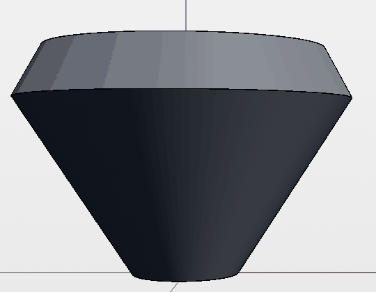
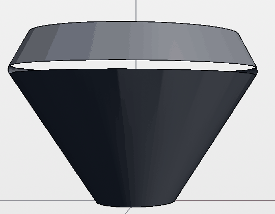
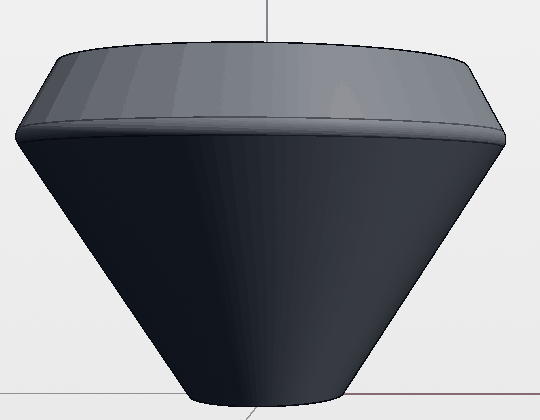

# Chamfered cone shoulder fillet in the browser (#1258)

`test/e2e/cone-shoulder-fillet.spec.ts` drives the issue's minimal sequence in
the built web app (Chromium, `VITE_E2E=1` build): a radius √29 mm circle
extruded 23 mm with −33° draft and its upper rim chamfered 6.1 mm are imported
as a project backup; the 1 mm fillet on the Z ≈ 17.884 mm shoulder is picked
in the viewport and applied through the selection chip. The shaded front view
is checked after the commit and again after a page reload.

Checks, at each step:

- The viewer's own display mesh (from the e2e render hook): zero boundary,
  non-manifold and inconsistent-winding edges, and no wall, chamfer or blend
  triangle facing the axis.
- Pixels: a column on the camera-facing wall at 0.125 mm steps from
  Z − 2.5 to Z + 2.5 mm must read as body: at least 60 levels off the open
  stage on the same row, and neutral (channel spread ≤ 30). The light theme
  is used so that even the unlit drafted underside is far from the stage.

| Remus | Display mesh after commit | Shoulder column | Result |
| --- | --- | --- | --- |
| 2026.1.135 (main pin) | 14,650 triangles; 0 boundary, 0 non-manifold, 0 inconsistent-winding edges; 0 inward | 41/41 samples body, minimum stage contrast 88, maximum chroma 11 (control: minimum contrast 81) | Pass after commit and after reload, 3/3 repeats |
| 2026.1.122 (`a16ca673`, the issue's pin, via `REMUS_WASM_PKG`) | 1,674 inconsistent-winding edges | 8 samples, Z 17.51–18.38 mm, show the stage (238/238/238) | Fails |

The screenshots are crops of the 1440 × 1000 viewport, colour-quantized to
64 levels to keep them small (the test samples the unquantized capture).

Chamfer-only control:

Remus 2026.1.122 after the fillet: the band is culled and the stage shows
through.

Remus 2026.1.135 after the fillet, commit and reload: the band is shaded.

