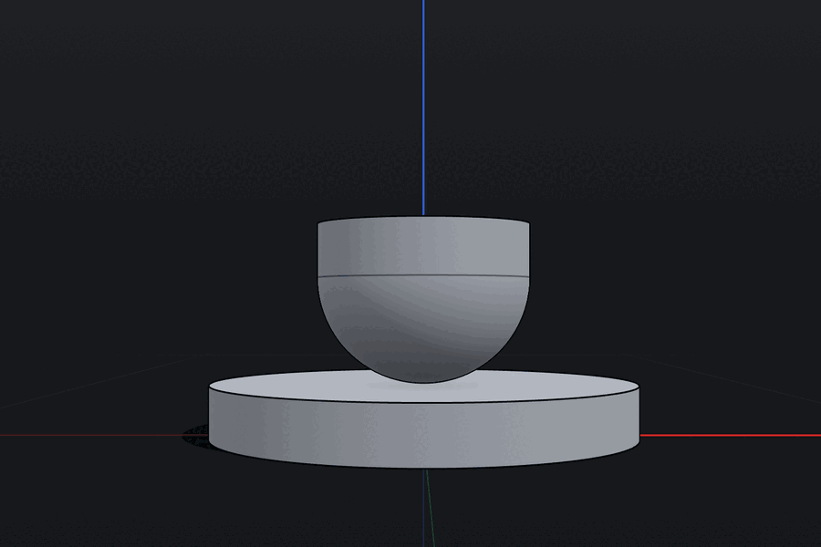
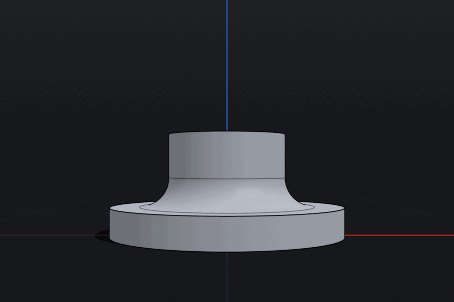
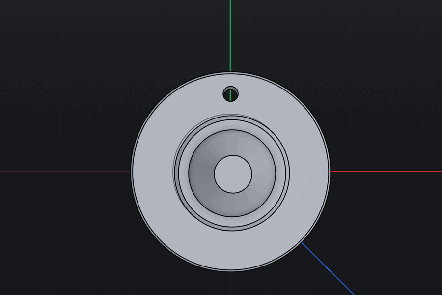

# Complex CAD models on production: kernel and app limits

An exploratory production QA pass on https://zcad.app, run on 2026-11-14. The
aim was to find where the exact kernel and the modeling UI give out on
realistic parts. Each part was built first and then changed with face offsets,
fillets and chamfers. This pass reports only; nothing was fixed.

## Setup

- **Build:** commit `527e681` (main at the time) with Remus `2026.1.136`.
  `f5b464b` deployed during the session (#1487–#1490, UI only, same Remus).
  Results come from `527e681` unless a row says otherwise. Agent D's
  undo/redo and reload checks ran on `f5b464b`. #1487 changes face-offset
  wording, so re-check the offset messages quoted below on the new build.
- **Browser:** Chromium in the T3 preview pane, `prefers-color-scheme: dark`,
  1280 × 800, signed out. No cloud, assistant, export or settings changes.
- **Driving:** one lead session plus four parallel agents. Each agent had its
  own tab and its own local project:
  - `QA 2026-11-14 · A prismatic`
  - `QA 2026-11-14 · B turned`
  - `QA 2026-11-14 · C enclosure`
  - `QA 2026-11-14 · D stress`
  - `QA 2026-11-14 · bracket fillets` (the lead)

  These projects are still in that browser profile's local library.

- **Evidence:** the per-feature status and `durationMs` in the
  `[geometry rebuild]` debug log, selection readouts (face area, size) and
  screenshots. No uncaught errors, rejected promises or worker crashes
  appeared in any session. Peak JS heap was about 225 MB.

## Highest-impact findings

Severity: P1 means wrong geometry or a feature that does not work. P2 means a
reasonable task is blocked or the result is misleading. P3 is polish. "Kernel"
means Remus refuses or builds a bad shape. "App" means the UI or document
layer.

### P1: silent wrong geometry

1. **A union of solids that only touch at a face leaves the contact face
   unmerged, and a later concave fillet is built as a convex round** (kernel
   boolean).
   - Repro: Cylinder r40 h10. Cylinder r20 h30 at z = 10, so its base sits
     exactly on the flange top. Union them, then fillet the hub-to-flange
     edge.
   - Observed: the flange top face reports 5026.55 mm², the full disc, where
     the annulus should be 3769.9 mm². The fillet rounds the hub foot inward.
     At R19.9 the hub turns into a hemisphere that barely touches the flange,
     and R20 is refused at the hub radius rather than the flange width.
   - Control: the same hub overlapping the flange (base at z = 5) gives the
     correct flare. A cone resting exactly on the hub did merge correctly.
   - Single observation (agent B), with screenshot evidence.

   
   

2. **Circular pattern ×4 followed by Subtract cuts only one bolt hole, with
   no warning** (kernel/app).
   - Repro: a tool cylinder r3 h20 at (0, 31, −5), Circular pattern ×4 about
     the bore axis, Subtract from the flanged hub.
   - Observed: the flange top area is 3088.19 mm². That matches one Ø6 hole
     removed; four would give 3003.4. The warning count stays at 0.
   - Single observation (agent B).

   

### P1: operations that cannot be used on ordinary parts

3. **Drafted walls cannot be filleted, in either order** (kernel).
   - Draft first: an edge between two 2° drafted faces is refused at R5 and
     R1 ("Can't round this edge here · Smaller radii were refused too").
   - Fillet first: a draft that touches a curved face is refused with "Remus
     draft refused: … corner 139 … re-trimming a curved neighbour … is not
     implemented".
   - A chamfer or fillet that meets an existing fillet on a drafted body
     fails at every size.
   - Net effect: a drafted enclosure with rounded corners cannot be built.
4. **Split by plane fails on any shelled or filleted body** (kernel). Every
   plane tried on a 2 mm shell with R5 fillets was refused:
   - through the fillets: "crosses curved edge 36";
   - x = 0: "crosses inner wire 0 of face 32";
   - z = 15: "face 18 … is not planar";
   - the default z = 0: "the cutting plane contains edge 36".
5. **Circular pattern and pattern booleans refuse disjoint pins** (kernel,
   exact-only policy).
   - Subtracting a patterned Ø6 pin through a flat 10 mm flange works at 2–4
     copies but is refused at 5, 6 and 8 copies with
     `exact_only_unattainable (quality_refused)`.
   - The pattern alone fails at 24 copies (after 1.7 s) and at 60 copies
     (after 4.3 s): "instance 2 could not be combined exactly". At 24 copies
     the pins are 8.1 mm apart on a Ø6 diameter, so they don't overlap.
   - Tracked broadly under [K01/K07](../../../ROADMAP.md#k01).
6. **Face offsets next to any blend are refused, even for ±1 mm** (kernel).
   - Base top face of a filleted L-bracket, 6 → 5 and 6 → 7 mm: "The exact
     kernel could not build this result."
   - A face between an R5 fillet and a tangent arc was refused at every
     value.
   - Flange top −2 mm on the turned hub: the detail is "blend-aware planar
     move requires a prismatic sharp support neighborhood".
   - Hub cylinder Ø40 → Ø44: refused because the adjacent blend "would be
     left behind".
   - With the blends suppressed, the same offsets build in about 2 ms.
   - Today face offset is effectively limited to sharp neighbourhoods
     ([K08](../../../ROADMAP.md#k08)).
7. **The closed loop of a pocket floor cannot be filleted at any radius**
   (kernel).
   - "Fillet edges" on a 3 mm-deep pocket floor is refused at R3, R1 and
     R0.3 ("Can't round these edges together … shared corner").
   - Single floor edges do build, but as approximate NURBS with a
     Diagnostics warning.
8. **Changing an early feature fails because "A selected edge no longer
   exists" when the edge still does** (app references, [K05](../../../ROADMAP.md#k05)).
   - Examples:
     - Box height 6 → 8 under chamfers.
     - Box depth 40 → 18 under a fillet.
     - Shelled box height 30 → 40.
     - Draft 2° → 3°, 10° or 30° under a fillet.
     - An early chamfer 1.5 → 2.0 under Cone, Union, Fillets and Thread
       (its preview built fine, but the commit was refused, 3 of 3 tries).
   - Edits are transactional ("Edit not saved … previous model is intact"),
     so nothing is corrupted.
   - The message sits on the edited feature's card, while the break is in a
     downstream feature, so "this feature" is ambiguous.
   - Not every edit fails this way: extrude height 30 → 45 replayed its
     fillets and shell correctly, and a flange-radius change replayed with
     clear "needs repair" badges.

### P2: misleading results and UX that blocks work

9. **The face-offset field sets the remaining thickness ("Total"), not the
   push distance** (app). Three agents ran into this independently.
   - The status hint says "Drag to push or pull the face, or type an exact
     distance".
   - Typing `5` on the top face of a 24 mm body recorded "Offset face · Top ·
     −19.01 mm".
   - Typing `1` on a 3 mm pocket floor cut the pocket 2 mm deeper.
   - The field switches silently between "Total" and a signed "Offset".
   - "Total 1e6" is accepted without any warning, giving a 1 km body.
10. **A typed radius after a new fillet edits the previous fillet** (app).
    - After adding Fillet 4 next to Fillet 3, the Picked chip still read
      "Fillet 3 R 3 mm".
    - Typing `2` + Enter changed Fillet 3, not Fillet 4.
11. **A fillet created from a refusal card cannot be edited in place** (app).
    The result is selected as a "Blend face", and typing a radius adds a new
    "Resize Blend r5" feature instead of editing the fillet.
12. **Solid offset**
    - It is refused on every filleted, shelled or thickened body ("assembly
      failed: wire loop walk: no unvisited edge from vertex 2685"). This
      matches the documented "sharp positive-outward" subset in
      [the capability matrix](../../capability-matrix.md), so it is a known
      limit. The raw message is still a P2.
    - On a plain 40 × 40 × 20 box, growing by +11 is refused as "oversized
      for the target solid's minimum extent". That cap only makes sense when
      shrinking.
13. **Outer convex fillet capped well below the geometric limit** (kernel).
    On the L-bracket's outer bottom edge, R5.9 builds but R6 is refused,
    although about 20 mm is geometrically possible.
14. **Holes behave inconsistently where they cross a pocket wall or fillet**
    (kernel).
    - Hole centres at X = 15, 16.5, 51.5–57.5 and 68–72.5 are refused with
      `exact_only_unattainable`.
    - X = 13.5, 67.5 and 74 build.
    - Crossing the left pocket wall from outside works; crossing the right
      wall from outside does not.
15. **Edge contact versus vertex contact is handled inconsistently**
    (kernel/app policy).
    - Boxes touching only at a corner are accepted as one body, but filleting
      all its edges is then refused.
    - Boxes touching along an edge are refused, with advice to "reposition
      the overlap" although nothing overlaps.
    - Grid pattern merges copies with 2 mm gaps into one body, while Union
      refuses gaps.
16. **Large patterns: the preview is not reused and there is no progress**
    (app).
    - The 10 × 10 grid on a ×50 bar took 72.6 s to preview, then Done
      recomputed it and replayed the whole history (another 70.3 s). The UI
      stayed responsive.
    - The preview card shows no progress, and the redo build has no Cancel.
    - Cancelling the 4 s pattern preview closes the card, but the worker keeps
      computing.
    - After the grid, "Picked: Union 2" still reads the pre-pattern size,
      1010 × 18 × 5 mm.
17. **Isolation leaves the other bodies hidden** (app). Isolate a body, then
    create or edit a feature. Isolation ends without notice, the other bodies
    stay hidden, and they stay hidden after a reload. Reproduced twice.
18. **Refusals show raw kernel text and ids** ("Remus … refused", `corner 139`,
    `face Some(Id(409))`, `exact_only_unattainable (quality_refused)`,
    `radius-too-large: resize blend`).
    - Subtracting two identical boxes is reported as "failed internally" for
      what is an empty result.
    - "Technical details" leaves the workspace for Settings › Activity log.

### P3: polish

- Suggested values in refusals are inconsistent:
  - "radius 15 mm builds here" is offered even when 19.9 builds.
  - "Smaller radii/distances were refused too" appears right after a smaller
    value built.
  - The floor-edge refusal blames "edges that end on an existing fillet"
    when the radius simply equals the 3 mm wall.
  - "Keep 4 mm" offers the first digit typed.
- The Box card needs a second Enter (or Done) after the Height field. The
  Corner fields are hidden in Options, and setting one adds a separate "Place
  Box" history step.
- The Circular/Grid pattern Count field sits inside a closed Options popover,
  and Done ignores a typed count (Enter applies it).
- `2,5` gives "Unexpected trailing tokens" with no decimal-point hint. The
  card keeps an old "Fillet r takes more than 0." error after the input
  changes.
- Naming and labels:
  - Inner shell faces are named by their outward normal (the inner back-left
    edge reads "Right · Front edge").
  - The rim and floor edges of one wall share a label.
  - The cone side face is "Face 18".
  - Thicken's new body reuses the source body's name.
  - Edge counts disagree between the rail (9) and the edit card (7).
- Picking reached a bore through the cone covering it, and once returned a
  hidden back edge.
- The Hole card's Typed U/V offsets are measured from the face's bounding-box
  centre, which is not shown anywhere. Edit Hole shows "Clicked" after
  "Typed" was chosen.
- A fresh tab auto-opened another session's locked project (designed
  read-only behaviour, but surprising as a landing page).
- The debug log reports a feature as `completed` while the UI shows it as
  failed.

## Measured limits

| Case                                         | Builds                  | Refused at | Geometric limit  |
| -------------------------------------------- | ----------------------- | ---------- | ---------------- |
| Fillet all 12 edges, 40 mm cube              | R19.6                   | R19.7      | just under 20    |
| Chamfer all 12 edges, 40 mm cube             | 19.99                   | 20         | 20               |
| Concave fillet, 44 mm upright                | 43.9                    | 44         | 44               |
| Convex outer fillet, 6 mm walls              | 5.9                     | 6          | ~20              |
| Pocket corner fillet, 20 mm wide             | 19.9                    | 20         | 20               |
| Pocket floor-edge fillet, 3 mm deep          | 2.9                     | 3          | 3                |
| Pocket floor closed loop                     | none                    | R0.3       | ~3               |
| Outer fillet, 2 mm shelled box corner        | 6.8                     | 7          | 6.83             |
| Inner concave fillet, shelled box            | 57                      | 59         | 58               |
| Rim chamfer, 2 mm wall                       | 1.9                     | 2.0        | 2                |
| Flange rim chamfer, 10 mm                    | 9.9                     | 10         | 10               |
| Bore entry chamfer                           | 8.4                     | 8.6        | 8.5              |
| Fillet next to a 3 mm chamfer                | 2.5                     | 3          | ~3               |
| Smallest fillet radius                       | 1e-4                    | 1e-5       | none             |
| Wall thinned by face offset (Total)          | 0.1                     | 0          | > 0              |
| Face offset beside any blend                 | none                    | ±1 mm      | none             |
| Fillet between 2° drafted faces              | none                    | R1         | none             |
| Solid offset, filleted/shelled body          | none                    | any value  | documented limit |
| Solid offset growth, 40 × 40 × 20 box        | +9                      | +11        | none             |
| Plane split, shelled body                    | none                    | any plane  | none             |
| Pattern + Subtract, Ø6 pins on a flat flange | 4 copies                | 5 copies   | none             |
| Circular pattern alone                       | ≤ 8                     | 24 (1.7 s) | none             |
| Grid 3×3 / 3×10 / 10×10 on a ×50 bar         | 3.2 s / 12.0 s / 72.6 s | —          | —                |

Single fillet, chamfer, hole and offset operations took 1–60 ms in the
kernel. Refusal searches took about 50 ms, a union with a cone 600–800 ms, and
a Thread 180–600 ms.

## What worked well

- Edits are transactional. A failed upstream edit always left the previous
  model intact and named the blocking feature.
- Fillet and chamfer limits on sharp prismatic geometry match the theory to
  within one step.
- Expressions (`10/3`), parameter prompts for unknown names, and refusals of
  zero or negative radii all work.
- Undo/redo storms and a reload in the middle restored the project intact.
- Shell, Thicken, Thread, coplanar subtracts and a 0.01 mm slab union all
  produced clean topology. Inspector volumes are exact.

## Harness notes (not app defects)

- Setting an input value from script showed the new value, but the app often
  kept the old one. Commits needed real keystrokes or Enter. `preview_act`
  typing into small card inputs timed out.
- Modifier keys did not reach canvas clicks, so Shift-select was done with
  synthetic pointer events. View-cube buttons ignored scripted `.click()`.
- The hidden preview tabs repainted only on screenshots, so the camera
  drifted between picks.

## Not covered

Gear teeth, multi-face offsets (opposite faces crossing), a 20 × 20 grid,
filleting a patterned union, sweeps, lofts, imports and exports.

## Suggested follow-ups

1. Turn findings 1 and 2 into kernel regressions:
   - the face-touching union, by checking contact-face area and the fillet
     sense;
   - pattern + subtract, by checking that the removed volume equals N holes.
2. Decide whether face offset "Total" should default to a signed distance,
   or change the hint to say thickness.
3. Track draft × blend, split through blends and offset beside blends as
   explicit capability rows, so users get one typed "not yet" message
   instead of raw kernel text.
