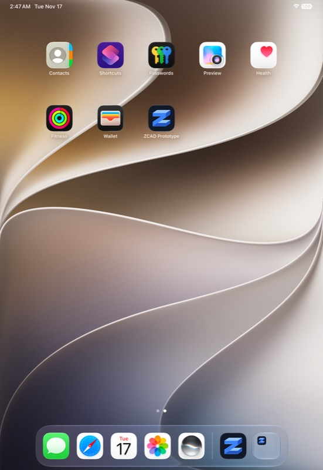
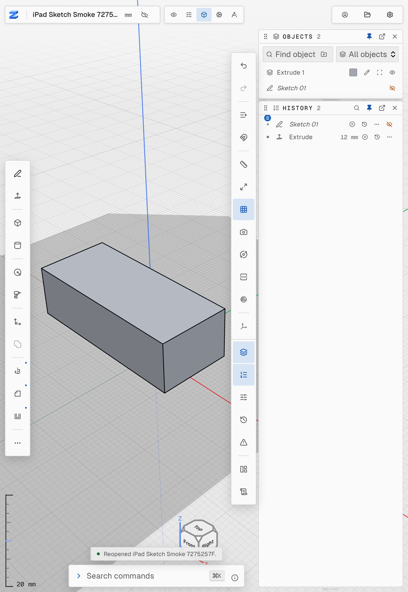
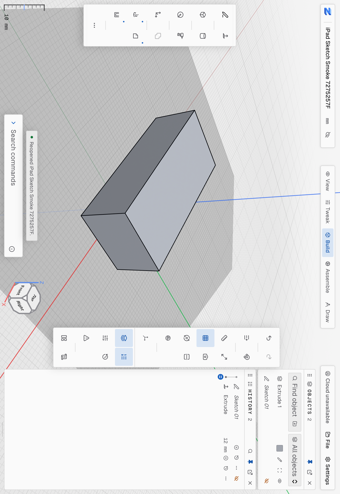
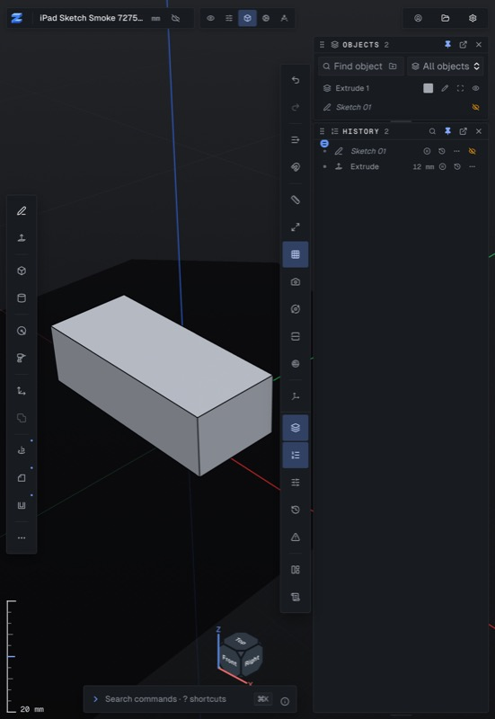
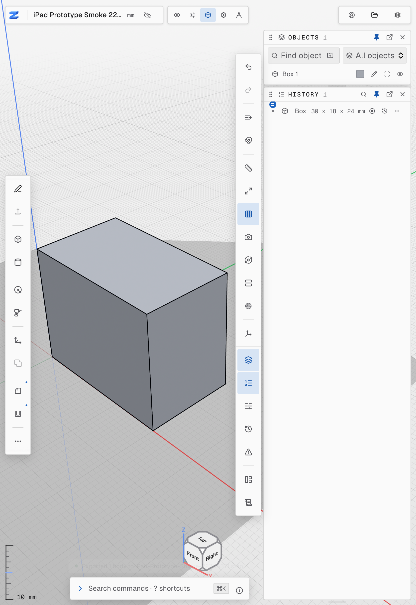

# iPad prototype verification

Verified on the iPad Pro 11-inch (M4) simulator, iPadOS 27.2, with Xcode 27.2.
This qualifies the native shell and shared CAD integration, not physical iPad
memory limits, Apple Pencil hardware, or App Store distribution. Device Hub
reported Agent device access disabled for this session; XcodeBuildMCP built,
installed, drove, and captured the requested simulator.

The ZCAD Prototype app is a local-only Swift/WKWebView host for the verified
React/Remus bundle. Resources use the app-private `zcad-ipad://app` scheme.
The native viewer fills the screen, hides the status bar, and auto-hides the
Home indicator. The default browser and macOS build modes retain their
existing behavior. Native iPad exports use the Files picker directly.

## Simulator results

All eight tests in the shared ZCADiPad scheme passed. Coverage includes:

- App icon present in the installed iPad bundle.
- Packaged-file boundaries, traversal refusal, and navigation restrictions.
- Private-origin secure context, module workers, and IndexedDB.
- Copying earlier prototype storage, preserving schema/indexes, typed-array
  offsets, files, dates, repeated references, settings, and original records.
- Creating a solid, terminating/relaunching the app, and reopening its model.
- Exporting STEP through the native Files picker and returning to the model.
- Touch rectangle sketch, a typed 12 mm extrusion, background/resume, and
  process termination/relaunch with both features and the solid preserved.
- Portrait and landscape WebView **and canvas** bounds matching the window.

The orientation test additionally waits for the physical screenshot's aspect
ratio to match the requested orientation. It passed after that capture check
was added. Screen captures were inspected in light and dark appearances; the
simulator's original light appearance was restored. The temporary UI-test
runner was removed from the Home Screen.

The final saved STEP file was read from the prototype's Documents directory:
7,635 bytes, an ISO-10303-21 header and terminator, and one
`MANIFOLD_SOLID_BREP`. Test projects live in a separate persistent WebKit store
and use unique names. Earlier prototype projects were copied into the private
origin while their original databases remained intact.

## Local checks

- `pnpm lint`: passed, with 18 existing warnings.
- `pnpm typecheck`: passed.
- Complete web Vitest project: 641 files, 7,654 tests passed.
- Root Vitest: 788 files passed and 14 skipped in the full run. Its new-app
  manifest check was corrected and passed in a targeted rerun; its D1 runtime
  suite initially lacked sandbox socket permission, then passed all four tests
  with local socket access. No failing root case remains from that run.
- `pnpm test:parity-corpus`: 97 passed, one skipped.
- `pnpm build`: passed, including bundle-size and Remus artifact checks.
- `pnpm prepare:ipad`, `pnpm dev:ipad`, `pnpm brand:check`, and the Git privacy
  guard: passed.

Hosted PR checks, merge-queue checks, and production deployment are separate
verification steps. The hosted web preview cannot run the native iPad shell;
the screenshots below and Xcode tests cover its UI.

## Independent review

Claude Opus 5.5, medium effort, reviewed the implementation and performed one
focused re-check. Resource hosting moved from TCP to the private WebKit scheme,
and UI-test storage was isolated. The re-check reported no blocking finding.
The recovery overlay is cleared after success, stale bootstrap completions are
ignored, and process recovery is capped. Broader recovery of unsupported or
oversized records from the earlier unshipped prototype remains deferred; that
path preserves the original data and refuses to discard it.

## Screenshots

